```html-embed
<p class="course-intro"><strong>この記事は、Udemyで公開中の動画講座『【動く図解でやさしく理解】情報処理安全確保支援士｜入門から試験範囲（科目A-2＆B）の情報セキュリティ知識を1講座で』の要点をまとめたものです。記事の末尾にクーポンを記載しているため、よろしければご利用ください。</strong></p>
<style>
  .course-intro { margin: 0; padding: 0.5rem; color: #b42323; background: #fff7f7; font: 1rem/1.7 system-ui, sans-serif; overflow-wrap: anywhere; }
  [data-theme="dark"] .course-intro { color: #ff9b9b; background: #2b1a1a; }
</style>
```

> **🎟 クーポンのコード**（URL・有効期限・先着枠は、記事の末尾にもまとめています）
> - 無料クーポン1：[`5FDD6BA75C86136A16DE`](https://www.udemy.com/course/information-security-overviewinformation-security-overview/?couponCode=5FDD6BA75C86136A16DE)（先着10名・2026年12月2日 20:57 まで）
> - 無料クーポン2：[`32640BF4256A21CFFC39`](https://www.udemy.com/course/information-security-overviewinformation-security-overview/?couponCode=32640BF4256A21CFFC39)（先着100名・2026年12月28日 20:57 まで）
> - 割引クーポン（1,500円）：[`77A1BF9B1EFA85646CDD`](https://www.udemy.com/course/information-security-overviewinformation-security-overview/?couponCode=77A1BF9B1EFA85646CDD)（2026年12月28日 20:57 まで）

ネットショップで、マグカップを1つ買う。スマホでログインして注文し、完了の画面が出るまでのあいだに、通信の道、お店の入口、サーバーの中で、いくつもの守りが働いています。

目を会社の全体に広げると、守る範囲は、社員のパソコン、社内のネットワーク、メール、クラウドへと広がります。そしてある冬、社員に届いた1通のにせのメールから、事故が起きます。

この記事では、架空の会社「サンプル商店」を舞台に、情報セキュリティの全体像を、次の2段階でたどります。

- **前半**：お客さん1人とサーバー1台。1回の買い物を、暗号、署名と証明書、認証、TLS、ファイアウォールで、端から端まで守る
- **後半**：会社の形に広げて、攻撃のしくみと防ぎ方、見張りと事故への対応、組織での管理と法律まで

細かな手順は省き、「どのしくみが、どこで、何を守るのか」という全体の地図を持ち帰ってもらうことを目標にしています。

**この記事で分かること**

- 「何を・何から・どう守るか」を整理する、機密性・完全性・可用性などの考え方
- 暗号・ハッシュ・デジタル署名・証明書・認証・TLS が、1回のログインと買い物のどこで、何を守っているか
- SQLインジェクション、XSS、CSRF、フィッシングなどの、しくみと防ぎ方
- 1通の標的型メールから始まる事故を、攻撃の道と、守る側の対応の両方から追う流れ
- リスクマネジメント・ISMS・法律・監査が、技術の守りとどうつながるか

**こんな方に向けています**

- 情報処理安全確保支援士試験を目指していて、範囲の広さに戸惑っている方
- セキュリティの担当になり、基本から全体を見渡したい方
- 開発や運用はしているけれど、守りの知識がばらばらの点になっている方

> 攻撃は「しくみ → 何が起きるか → 防ぎ方」の組で説明し、そのまま使える攻撃の手順や文字列は書きません。手元で試すのは、自分の機器と自分のアカウント、許可された環境だけにしてください。他人の機器やサービスに試すことは、法律に触れるおそれがあります。

---

## 0. 全体の地図：何を、何から守るか

舞台は、社員30人ほどの架空の会社「サンプル商店」です。ネットショップを運営していて、情報システムの担当になったばかりのミナトさんが、お店と会社を1つずつ守っていきます。お客さんのユイさんは、スマホでお店のサイト（`shop.example.jp`）にログインし、マグカップを1つ買おうとしています。

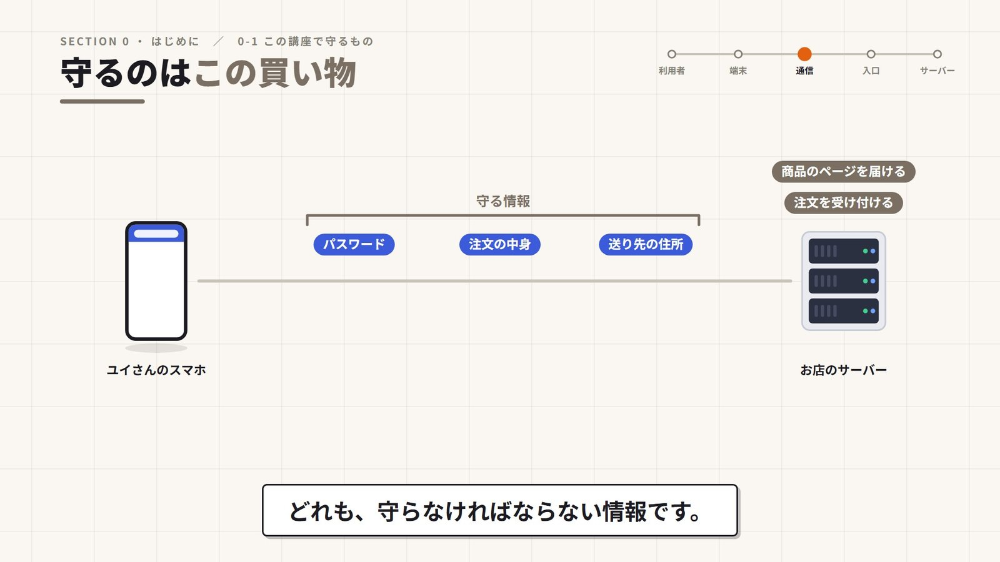

守る価値のある情報と、それを扱う物を、まとめて **情報資産** と言います。ログインのパスワード、注文の中身、送り先の住所は、どれも守らなければならない情報です。このやりとりで起きてほしくないことは、4つあります。

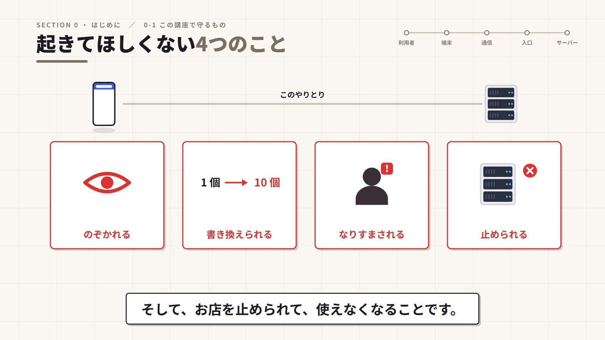

| 起きてほしくないこと | 守る性質 | 性質の意味 |
|---|---|---|
| 途中で、中身をのぞかれる | **機密性** | 許された人だけが、情報を見られること |
| 中身を、勝手に書き換えられる | **完全性** | 情報が正確で欠けがなく、改ざんされていないこと |
| ユイさんやお店に、なりすまされる | **真正性** | 相手が、名のったとおりの本物であること |
| お店を止められて、使えなくなる | **可用性** | 許された人が、必要なときに使えること |

機密性（Confidentiality）・完全性（Integrity）・可用性（Availability）の3つを、頭文字から **CIA** と呼びます。これに、**真正性**、だれの操作かをあとからたどれる **責任追跡性**、あとで否定されても証拠で示せる **否認防止**、意図どおりに動く **信頼性** を加えた、7つの性質で考えることもあります。

害の原因を **脅威**、脅威に突かれるこちらの弱い所を **脆弱性** と言います。この2つがそろうと、害が出るおそれ、つまり **リスク** になります。リスクは、起こりやすさと影響の大きさの2つで捉えます。

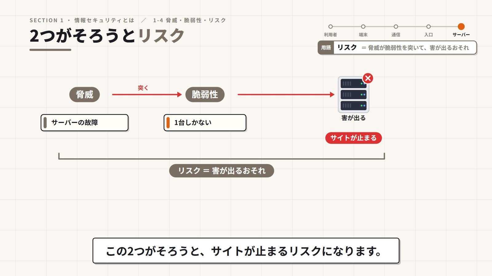

絶対の安全はありません。新しい弱点は見つかり続け、人はまちがえます。だから、守りを何重にも重ねる **多層防御**、決めた物だけを許す **既定で拒否** などの原則で、リスクを小さくし、起きたら気づいて立て直せるようにしておきます。

この記事でも、講座と同じく、ユイさんからお店までの1本の道を、5つの場所に分けて追います。

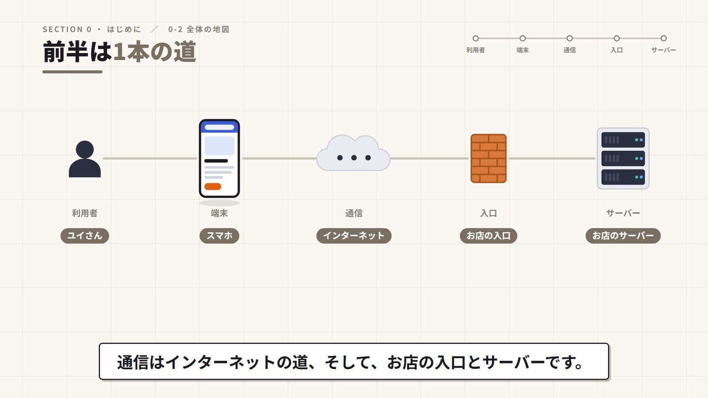

### ネットワークは「本物か」を確かめていない

守りのしくみを見る前に、ふだんの通信が何を確かめていないかを、押さえておきます。ネットワークの基本のしくみは、運ぶことが仕事で、相手が本物かまでは確かめていません。

| しくみ | 運ぶもの | 確かめていないこと |
|---|---|---|
| LANの中（イーサネット） | 宛先と送り主の MACアドレス | 送り主の MACアドレスが本物か |
| IP | 宛先と送り主の IPアドレス | 送り主の IPアドレスが本物か |
| ARP・DHCP | IPアドレスと MACアドレスの対応、住所などの設定 | 答えた相手が本物か |
| TCP・UDP | ポート番号など | 相手がだれか |
| DNS | 問い合わせと、レコードの答え | 答えの中身が本物か |
| HTTP | メソッド、パス、ヘッダー、本文 | リクエストに書かれた値を使ってよいか |
| Cookie | セッションID | IDを送ってきたのが本人か |
| メール（SMTP） | 封筒の差出人と宛先、ヘッダーと本文 | 差出人が本物か |

この「確かめていない所」が、あとで見る攻撃の入口になり、守りのしくみが埋める穴になります。

---

## 1. かくす：共通鍵暗号・公開鍵暗号・鍵交換

**暗号化** は中身を読めない形に変えること、**復号** は元に戻すことです。暗号は、手順（暗号アルゴリズム）と **鍵** の2つでできていて、秘密にするのは手順ではなく鍵です（ケルクホフスの原理）。

- **共通鍵暗号**：暗号化と復号に、同じ鍵を使います。今の標準は **AES** で、DES とトリプルDES は古い方式です。長いデータはブロックに分け、**暗号利用モード** を決めて暗号化します。同じ平文が同じ暗号文になる ECB モードは、ふつう使いません。
- **鍵配送問題**：共通鍵は、やりとりする2人の組ごとに別のものが要ります。全員どうしでやりとりすると、10人で45本、1000人ではおよそ50万本です。しかも、初めて来たお客さんとは、先に共有した秘密がありません。
- **公開鍵暗号**：公開鍵で暗号化し、組の **秘密鍵** で復号します。公開鍵は見られてもよい鍵で、秘密鍵は1度も通信の道を通りません。代表は、素因数分解の難しさを使う **RSA** と、別の計算を使う **楕円曲線暗号** です。ただし、処理が遅いのが弱点です。

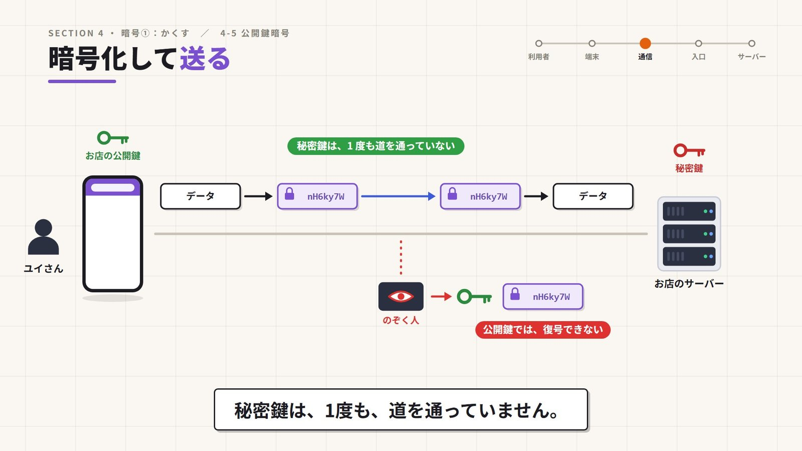

- **鍵交換**：鍵そのものを送らずに、2人が同じ秘密の値を作る方法です。代表は **DH** で、楕円曲線を使うものを **ECDH** と言います。途中のやりとりをのぞいた人には、同じ値を作れません。ただし、鍵交換だけでは、相手が本物かは確かめられません。

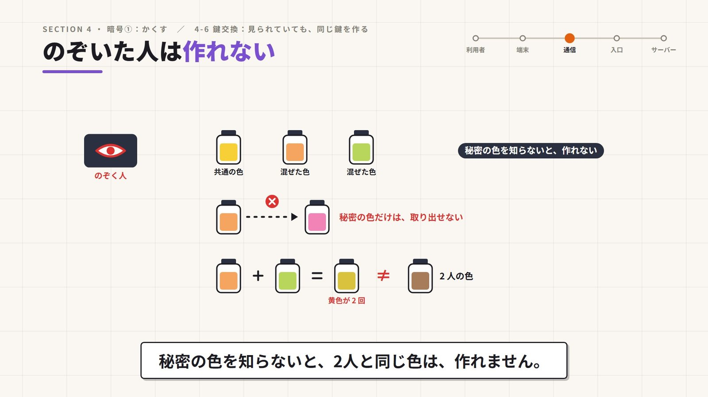

実際の通信では、両方のよい所を組み合わせた **ハイブリッド暗号** を使います。データは速い共通鍵暗号で暗号化し、その共通鍵は、公開鍵暗号で送るか、鍵交換で2人の手元に作ります。1回の通信のあいだだけ使う共通鍵を、**セッション鍵** と言います。

---

## 2. 確かめる：ハッシュ・MAC・デジタル署名

かくすだけでは、書き換えや、なりすましには気づけません。そこで、「確かめる」ための道具を使います。

- **ハッシュ関数**：データから、決まった長さの **ハッシュ値** を計算します。ハッシュ値から元のデータには戻せません。違うデータが同じハッシュ値になる組（衝突）は必ずありますが、SHA-256 などの今の方式では、その組を現実的には見つけられません。MD5 と SHA-1 は、衝突する組を作る方法が見つかっているので、新しく使いません。
- **メッセージ認証コード（MAC）**：データと共通鍵から計算する値です。合えば、改ざんが無いことと、共通鍵を持つだれかが作ったことが分かります。暗号化と改ざんの検知を1度に行うのが、**認証付き暗号** です。
- **デジタル署名**：秘密鍵で署名し、公開鍵で検証します。検証で分かるのは、改ざんが無いことと、組の秘密鍵で署名されたことです。

| | 作るのに使うもの | 確かめられる人 | 分かること |
|---|---|---|---|
| ハッシュ値 | データだけ（鍵は使わない） | だれでも | ハッシュ値が違えば、元のデータも違う |
| MAC | データと共通鍵 | 同じ共通鍵を持つ人 | 改ざんが無いこと、共通鍵を持つだれかが作ったこと |
| デジタル署名 | データと秘密鍵（検証は公開鍵） | 公開鍵を持つ、だれでも | 改ざんが無いこと、組の秘密鍵で署名されたこと |

MAC は、確かめる側も同じ鍵で同じ値を作れるので、「だれが作ったか」の証拠にはなりません。署名は、条件がそろえば **否認防止** の証拠になります。ただし、「その人が作った」と言うには、使った公開鍵が本当にその人のものであることが、別に要ります。それを確かめるのが、次の PKI です。

---

## 3. その公開鍵は本物か：PKI

公開鍵は、通信の道ですり替えられることがあります。あいだに割り込んで、気づかれずに中継する攻撃が **中間者攻撃** です。そこで、公開鍵が本当に相手のものかを確かめます。

- **デジタル証明書**：公開鍵と持ち主の名前などに、**発行者が署名** したものです。中身は、主体者、公開鍵、有効期間、発行者、署名など。書式の標準は X.509 です。
- **認証局（CA）**：証明書を発行する機関です。お店の証明書には **中間CA** が署名し、中間CAの証明書には **ルートCA** が署名します。
- **信頼の連鎖**：端末は、この **証明書チェーン** の署名を下からたどり、端末の中にあらかじめ入っている **トラストアンカー** に着くかを確かめます。有効期間と、つなごうとした名前も確かめます。

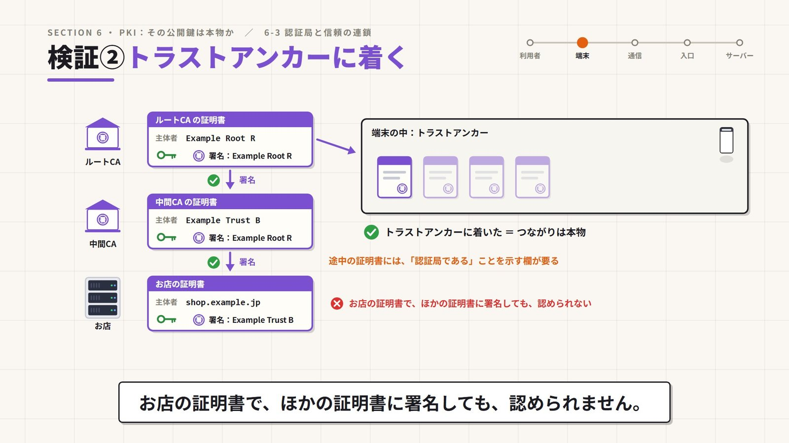

このしくみ全体を **公開鍵基盤（PKI）** と言います。有効期間の途中で証明書を無効にすることを **失効** と言い、失効した証明書の一覧（CRL）や、証明書ごとの問い合わせ（OCSP）で確かめます。

---

## 4. 本人を確かめる：認証とアクセス制御

**識別** はだれであるかを見分けること、**認証** は本人かを確かめること、**認可** は認証された人に何を許すかを決めることです。認証の要素は、**知識情報**（パスワードなど）、**所持情報**（スマホなど）、**生体情報**（指紋など）の3つです。

### パスワードの保存：ハッシュ・ソルト・ストレッチング

お店は、パスワードをそのまま保存せず、ハッシュ値にして保存します。さらに、利用者ごとに違う値の **ソルト** を加えて、同じパスワードでも同じハッシュ値にならないようにし、前もって計算した対応表での逆引きを防ぎます。そして **ストレッチング** で計算をわざと重くし、漏れたときに候補を試しにくくします。

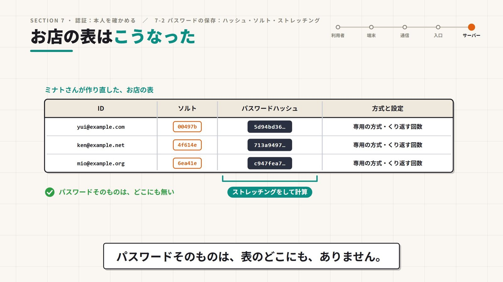

### 多要素認証とパスキー

- **ワンタイムパスワード**：1回だけ使えるパスワードです。時刻から作る TOTP、回数から作る HOTP があります。ただし、にせのサイトに入力すると、渡ってしまいます。
- **多要素認証**：種類の違う要素を、2つ以上組み合わせます。段階が2回あることを指す **2段階認証** は、要素の種類を問わないので、区別して使います。
- **FIDO とパスキー**：認証器（スマホなど）の中の秘密鍵で、サーバーからのチャレンジに署名します。サーバーに置くのは公開鍵などで、秘密鍵は置きません。パスキーはドメインごとに別なので、**にせのサイトでは使えません**。

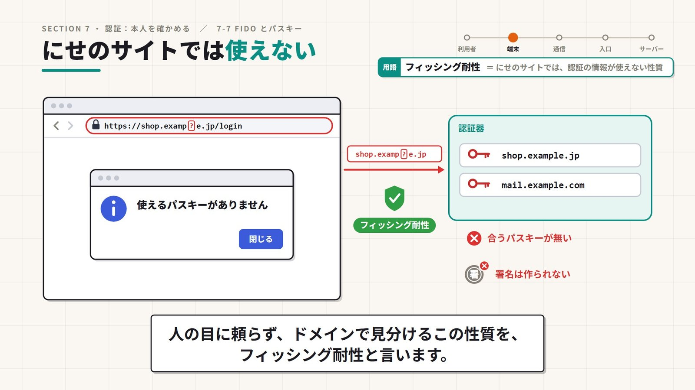

### アクセス制御

ログインできた人でも、何でもできるわけではありません。**アクセス制御** は、だれ（主体）が、何（対象）に、何をする（操作）かの組で、許す範囲を守ります。対象ごとに許可を並べた一覧が **ACL** です。

- 決め方には、持ち主が決める **任意アクセス制御**、決まりが決める **強制アクセス制御**、役割で決める **ロールベース**、条件で決める **属性ベース** があります。
- **最小権限の原則**：仕事に必要な分だけの権限を与えます。
- **職務の分離**：確かめ合うべき仕事を分けて、1人で完結させません。

---

## 5. 通信の道を守る：TLS 1.3

**TLS** は、通信の相手を確かめ、中身を暗号で守る約束です。HTTP を TLS で守った道の中で行うのが **HTTPS** です。TLS は、**機密性・完全性・真正性** の3つを守ります。

ここまでの部品は、TLS 1.3 のハンドシェイクの中で、次の順に使われます。

1. **ClientHello**：TCP でつながったら、スマホは、使える方式の一覧（**暗号スイート**）と、鍵交換の値を送ります。行き先のサイトの名前（**SNI**）も入っています。
2. **ServerHello**：サーバーは、選んだ方式と、鍵交換の値を返します。
3. **同じ鍵を作る**：2人は、それぞれの秘密の数と届いた値から同じ秘密の値を作り、そこから共通鍵を作ります。ここから先のハンドシェイクは、暗号化されます。
4. **証明書**：サーバーは、お店の証明書から中間CAまでの証明書チェーンを送り、スマホが3章の手順で検証します。
5. **署名（CertificateVerify）**：サーバーは、鍵交換の値を含むやりとりに秘密鍵で署名し、スマホが証明書の公開鍵で検証します。これで、つなごうとした名前のサーバーだと判断できます（**サーバー認証**）。
6. **Finished**：両方が Finished を送り、やりとり全体を確かめます。

データ用の共通鍵は、サーバーの Finished までのやりとりから作ります。スマホは、自分の Finished に続けて、認証付き暗号で守った HTTP のリクエストを送れます。サーバーが最初の鍵交換の値を使えれば、ハンドシェイクは **1往復** で済みます。

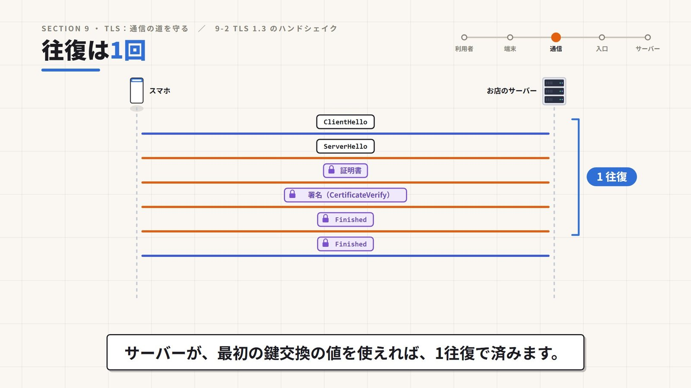

押さえておきたい点が3つあります。

- **前方秘匿性**：鍵交換の秘密の数は、接続のたびに作って、終われば捨てる一時的なものです。そのため、サーバーの長期の秘密鍵があとで漏れても、過去の通信は読まれません。
- **証明書の鍵でデータを暗号化するのではない**：TLS 1.3 では、証明書の公開鍵は署名の検証に使い、データは、鍵交換から作った共通鍵で暗号化します。
- **鍵マークは「良いお店」の保証ではない**：にせのサイトも、自分の名前の証明書で暗号化できます。鍵マークで分かるのは、アドレス欄の名前のサーバーと、暗号で守った道でつながっていることまでです。

古い版や弱い方式は止めておき（ダウングレード攻撃への備え）、**HSTS** で、ブラウザに HTTPS だけでつなぐよう指示します。証明書の警告が出たら、確かめられない限り先へ進まないのが基本です。

---

## 6. 入口を守る：ファイアウォールとDMZ

**ファイアウォール** は、規則に沿って、通すか止めるかを決めます。

- **パケットフィルタリング**：IPアドレスやポート番号など、ヘッダーの情報で選びます。サンプル商店のファイアウォールは、規則の表を上から順に見て、最初に合ったルールで決め、最後はすべてを拒否するルールで締めくくります（最後のルールを書かなくても、合わなければ止める作りのものもあります）。
- **ステートフルインスペクション**：行きの通信を覚えておき、それに合う返事だけを通します。通信が終われば表から消すので、返事のための穴は、必要なあいだだけ開きます。
- **DMZ**：ネットワークを、外・DMZ・中の3つの場所に分けます。DMZ には公開するサーバーを置き、外からは決めた通信だけを通します。

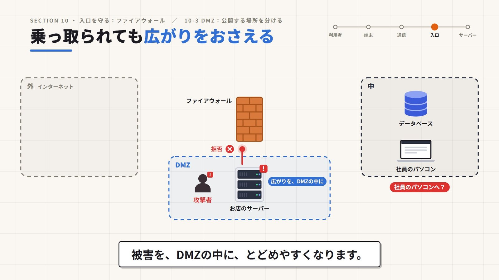

ただし、DMZ に置けば安全、ではありません。DMZ は、乗っ取られたあとの広がりをおさえる場所です。許可したデータベースへの通信は、乗っ取られたサーバーからも使えます。

---

## 7. 前半の通し：ログインから買い物まで

ここまでの部品で、ユイさんの1回の買い物を、通る順に見直します。

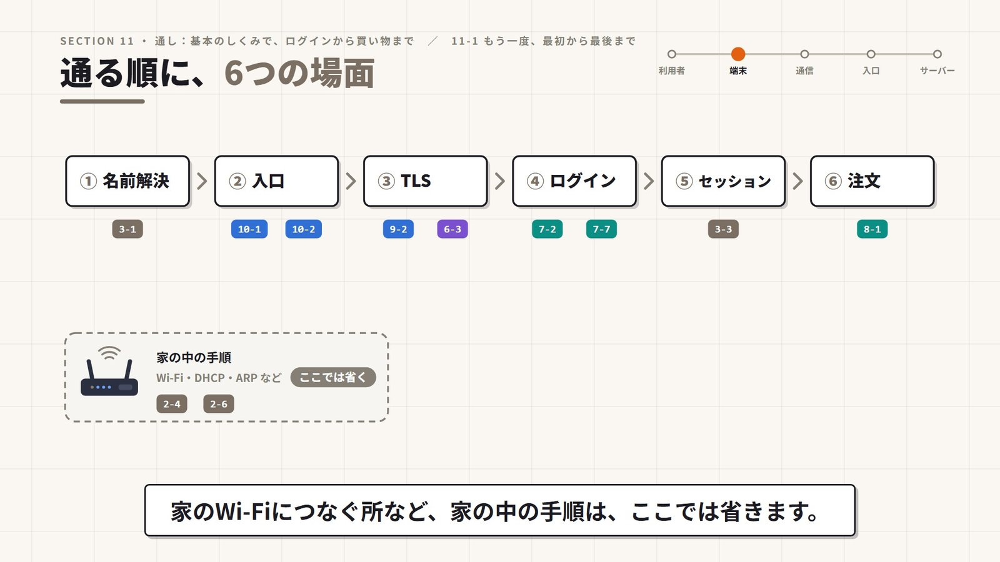

1. **名前解決**：お店の名前から、サーバーの IPアドレスを調べます（DNS）。ただし、基本の DNS は、答えが本物かを確かめていません。
2. **入口**：スマホは `443` 番に TCP でつなぎにいきます。入口のファイアウォールが、決めた通信だけを通し、その返事も通します。
3. **TLS**：鍵交換で共通鍵を作り、証明書と署名でサーバーを確かめ、通信の道を暗号で守ります。
4. **ログイン**：ユイさんはメールアドレスで名のり（識別）、パスワードは TLS の道の中を通ります。サーバーは、ソルトとストレッチングで保存した値と照らし、アプリのワンタイムパスワードも確かめます（多要素認証）。パスキーを登録してあれば、パスワードは入力しません。
5. **セッション**：認証が通ると、サーバーは新しいセッションIDを作り、Cookie でブラウザに渡します。次からのリクエストには、このIDが付きます。
6. **注文**：注文は、処理を頼む POST で届きます。サーバーは、注文を作るのが認可した範囲かを確かめ、ほかの人の注文は見せません。DMZ のお店のサーバーは、中の区画のデータベースに、必要な分だけの権限で書き込みます。

どのしくみが、どの性質を守ったかをまとめると、こうなります。

| 性質 | 守ったしくみ |
|---|---|
| 機密性・完全性 | TLS（暗号化と、書き換えの検知）、アクセス制御、ファイアウォール |
| 真正性 | 証明書と署名（サーバー）、多要素認証やパスキー（利用者） |
| 責任追跡性 | アカウントごとの記録（ただし、本人の操作かは別に確かめる） |
| 否認防止・可用性・信頼性 | 基本のしくみでは、まだ手薄（注文に署名はしていない、サーバーは1台） |

よくある誤解が、「暗号化していれば安全」というものです。暗号化が直接守るのは、主に機密性です。届いたあとのデータや、ログインした人の操作は、別のしくみで守ります。

そして、基本のしくみでは、まだ守れていないことが5つ残ります。

- ① 入口で通した **通信の中身**（正しい形をした、悪い入力）
- ② お店の **プログラムの誤り**
- ③ にせのサイトや、だます手口にかかる **人**
- ④ 社員のパソコン、社内のネットワーク、メール、クラウドなどの **会社の中**
- ⑤ 事故が **起きたあとの対応**

後半は、この5つを、前半のしくみを部品として使いながら、順に守っていきます。

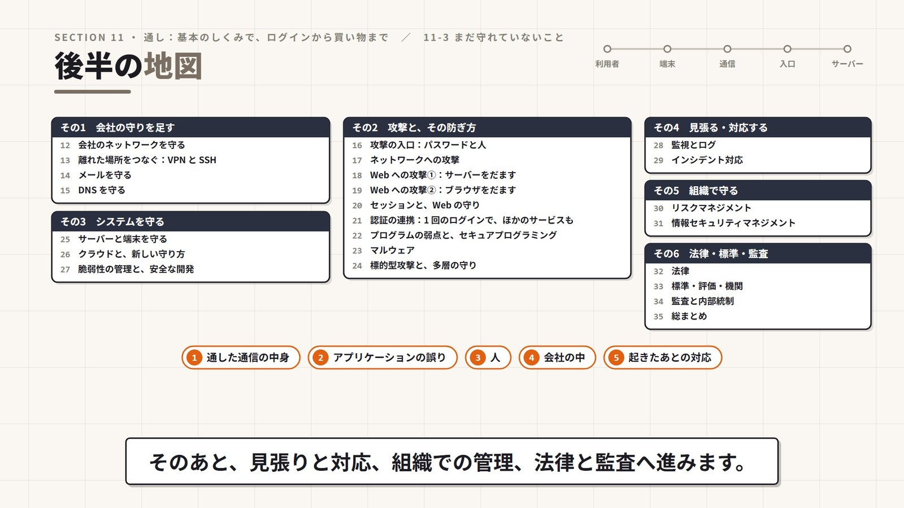

---

## 8. 後半①：会社のネットワーク・VPN・メール・DNSを守る

サンプル商店のネットワークは、社内LAN、DMZ、出入口でできていて、外にはクラウドや、自宅で働く社員がいます。境界で守る考え方を **境界型防御** と言いますが、「境界の中は信用する」という前提に弱さがあります。持ち込んだ端末や無線LANの電波は、出入口を通らずに中へ入ります。だから、境界の中でも、分けて、確かめて、見張ります。

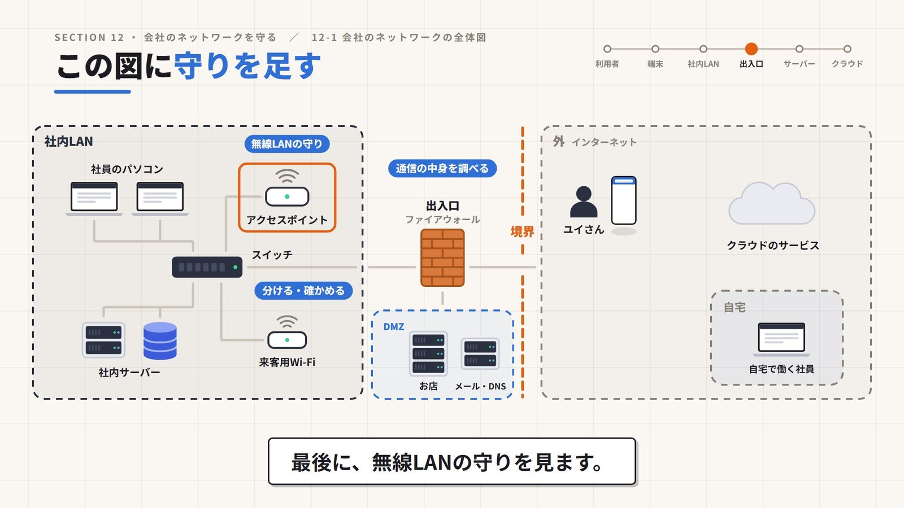

- **プロキシとSWG**：外へ出る通信を、行き先と中身で選び、記録します。HTTPS の中身は、代わりの証明書を使う **復号検査** で調べます。中間者攻撃と同じ形なので、決まりと管理が要ります。
- **IDS と IPS**：IDS は攻撃らしいものを見つけて知らせ、IPS はさらに止めます。登録した特徴と比べる **シグネチャ型** と、いつもと違う動きを見つける **アノマリ型** があり、誤検知と見逃しはつり合いです。
- **分けて、確かめる**：VLAN で区画を分け、あいだの通信をしぼります。**IEEE 802.1X** は、LAN につなぐ機器を、通信の前に認証します。無線LAN は、WEP を使わず、WPA3 か、AES を使う WPA2 にします。
- **VPN**：共用のネットワークの上に、仮想の専用の道を作ります。**IPsec** では、AH が改ざんの検知と認証を行い、ESP は暗号化も行えます（中身を隠すには、暗号化を使う設定にします）。ただし、「VPN でつなげば安全」ではありません。つないだパソコンが乗っ取られていれば、攻撃者の通信もトンネルを通って社内に届くので、つなぐ人と端末を確かめ、使える範囲もしぼります。
- **SSH**：遠くの機器を、暗号で守った道の中で操作します。ホスト鍵の確認が出たら、フィンガープリントを見比べます。

### メールを守る：SPF・DKIM・DMARC

もともとの SMTP は、差出人が本当かを確かめません。そこで、受け取る側が DNS の情報を使ってドメインを確かめる **送信ドメイン認証** を使います。

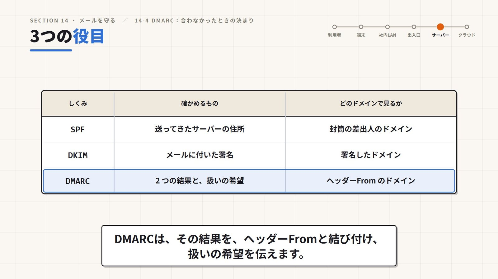

**SPF** と **DKIM** は、画面に出る差出人（ヘッダーFrom）と別のドメインでも、確認に通ってしまいます。そこで **DMARC** は、SPF か DKIM のどちらか一方に通り、そのドメインがヘッダーFrom のドメインと合えば（アラインメント）、通ったと判定します。通らなかったメールをどう扱ってほしいかは、ドメインの持ち主が宣言します。運ぶ道の暗号化（STARTTLS）は1区間ずつ、S/MIME などは送る人から読む人まで、中身を守ります。

### DNSを守る

**DNSキャッシュポイズニング** は、リゾルバに、にせの答えを覚えさせる攻撃です。問い合わせの番号とポート番号をでたらめにし、問い合わせを受け付ける相手をしぼって守ります。**DNSSEC** は、DNS の答えに署名を付け、リゾルバがルートから署名をたどって、答えが本物かを確かめるしくみです。DoT や DoH は問い合わせを暗号化しますが、守るのはリゾルバまでの道で、答えが本物かを確かめるのは DNSSEC の役目です。

---

## 9. 後半②：攻撃のしくみと防ぎ方

攻撃は、おおまかに **調べる → 入る → 広がる → 目的を果たす** と進みます。主な攻撃を、しくみと守りの組で並べます。

| 攻撃 | しくみ | 主な守り |
|---|---|---|
| パスワードを試す攻撃（総当たり、辞書、パスワードスプレーなど） | 候補を次々に試す | 回数の制限、全体の見張り、多要素認証 |
| パスワードリスト攻撃 | 漏れたIDとパスワードの組を、ほかのサービスで試す | 使い回さない、多要素認証 |
| フィッシング | 本物を装い、パスワードなどをだまし取る | ドメインで見分ける FIDO の認証、ブックマークや公式のアプリから開く |
| ビジネスメール詐欺（BEC） | 取引先や上司を名のり、偽りの口座へ振り込ませる | メールの外で確かめ直す、お金の手続きは別の人が承認 |
| ARPスプーフィング | にせの ARP 応答などで、アドレスの対応を偽る | スイッチの検査の機能、機器の認証、暗号化 |
| SYNフラッド | SYN を大量に送り、準備の席を埋める | SYNクッキー |
| DDoS・リフレクション | たくさんの機器から送る。送信元を偽り、返事を標的へ向けさせる | CDN や対策のサービス、接続事業者の設備、レート制限 |
| SQLインジェクション | 入力が、SQL の文の骨組みの一部として読まれる | プレースホルダー |
| OSコマンドインジェクション | 入力が、別の命令として実行される | シェルを呼ばない。別のプログラムが要るなら、シェルを通さず、決めた形の値だけを引数として分けて渡す |
| ディレクトリトラバーサル | 決めたフォルダの外のファイルを指される | 入力から場所を作らない、正規化してから確かめる |
| クロスサイトスクリプティング（XSS） | 攻撃者のスクリプトが、お店のページで動く | 出力する場所に合わせたエスケープ処理 |
| CSRF | ログイン中の利用者に、意図しないリクエストを送らせる | CSRFトークン、SameSite、大事な操作の前の再認証 |
| セッションハイジャック | 他人のセッションIDで、その人になりすます | 知られにくくし、使える時間を短くし、確かめ直す |
| 認可制御の不備 | してよいかの確かめが抜け、見えてはいけないものが見える | リクエストのたびに、サーバーの側で主体・対象・操作を確かめる |

### SQLインジェクションの根本の守り：骨組みと値を分ける

入力を文字のままつなげて SQL の文を作ると、入力の中の記号で値が途中で終わり、残りが文の骨組みとして読まれてしまうことがあります。**プレースホルダー** を使うと、文の骨組みを先に決め、値はあとから割り当てます。値が何であっても、文の骨組みは変わりません。

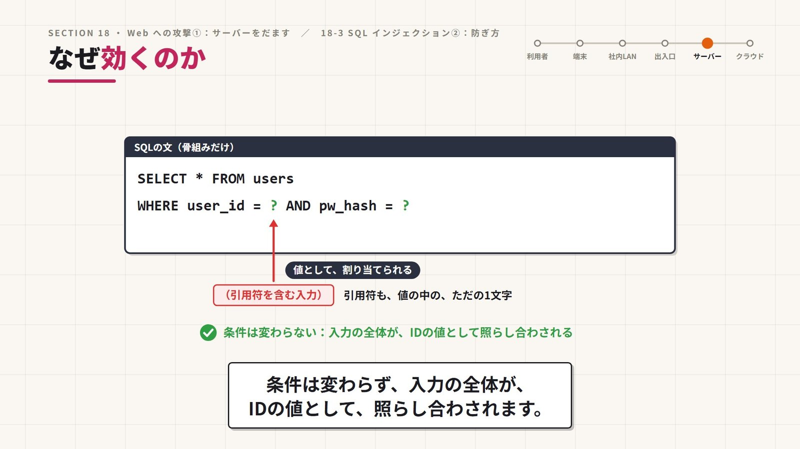

データのつもりの入力が、命令として読まれるのが **インジェクション** です。守りは、受け取るときの入力値の検証と、渡すときの処理（骨組みと値を分ける、出力する場所に合わせてエスケープする）の2つです。

### ブラウザの仕切りと、その穴

ブラウザには、別のオリジン（スキーム・ホスト名・ポート番号の組）の中身を直接読み書きさせない **同一オリジンポリシー** があります。ただし、別のサイトへ「送ること」と、そのときに Cookie が付くことは止めていません。CSRF は、この穴を突きます。XSS は、攻撃者のスクリプトがお店のオリジンの中で動くので、仕切りの内側から中身を読み、操作できてしまいます。

Cookie には、HTTPS のときだけ送る **Secure**、JavaScript に読ませない **HttpOnly**、別のサイトから始まったリクエストに付けるかを決める **SameSite** などの属性があります。HttpOnly や CSP は、XSS の抜けがあったときの被害を小さくする守りで、根本はアプリケーションを直すことです。HTTP の中身を検査して攻撃とみられる通信を止める **WAF** も、補う守りです。

---

## 10. 後半③：認証の連携 ― SSO・SAML・OAuth・OpenID Connect

1回の認証で、いくつものサービスを使えるしくみが **シングルサインオン（SSO）** です。認証の結果を発行する **IdP** と、それを検証してサービスを出す **SP** に分かれます。IdP のアカウントを乗っ取られると、つないだサービスにも入られるおそれがあるので、IdP は多要素認証などで強く守ります。

| しくみ | 役目 | 要点 |
|---|---|---|
| Kerberos | 社内などのシングルサインオン | KDC が出すチケットで認証し、パスワードはネットワークに流さない |
| SAML | 認証の結果を、XML の書類で渡す | IdP が署名したアサーションを、ブラウザ経由で SP へ渡す |
| OAuth 2.0 | パスワードを渡さずに、権限をゆだねる | 認可コードを、アプリがアクセストークンと引き換える。スコープと期限でしぼる |
| OpenID Connect | 認証の結果を伝える | 署名付きの IDトークンを、アプリが検証する |

OAuth 2.0 では、戻りのリクエストが自分の始めた流れの続きかを確かめる **state**、元の値を知っているアプリだけに認可コードを引き換えさせる **PKCE**、登録した戻り先のURLとの完全な一致の確認が、落とし穴をふさぎます。

---

## 11. 後半④：プログラムの弱点、マルウェア、標的型攻撃

- **バッファオーバフロー**：バッファの大きさを超えて書き込み、リターンアドレスなどを上書きしてしまう誤りです。書き込む前に長さを確かめるのが基本で、OS とコンパイラも、**スタックカナリア**、**DEP**（実行を禁じた場所で命令を動かさない）、**ASLR**（置き場所をでたらめにする）で守ります。
- **競合状態**：処理のタイミングしだいで、誤った結果になる状態です。確かめてから使うまでのすき間で、状態が変わってしまう **TOCTOU** は、その一例です。
- **マルウェア**：害を与えるために作られたソフトウェアの総称です。メールの添付やリンク、文書のマクロ、ページを見ただけで入るドライブバイダウンロードなどから入り込みます。**ランサムウェア** は、データを使えなくして身代金を求めます。盗んだデータの公開でもおどす手口を、**二重脅迫** と言います。
- **標的型攻撃**：特定の組織や人をねらう攻撃です。攻撃の流れを段階で考える **サイバーキルチェーン** や、攻撃者のやり方を戦術と技術で整理した **ATT&CK** が使われます。

標的型攻撃には、守りを3つの場所に重ねて備えます。

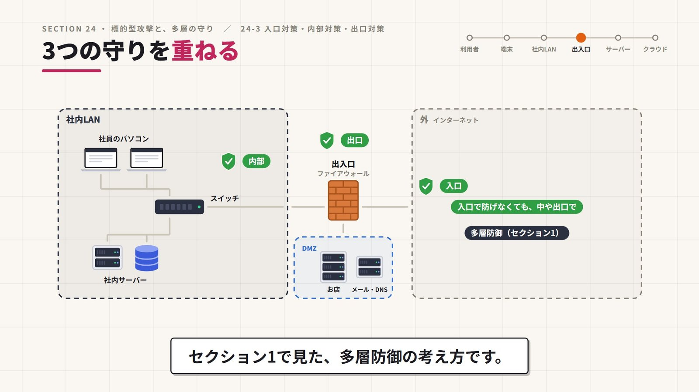

- **入口対策**：メールや Web、外からの通信を調べて、入ってくるのを防ぐ
- **内部対策**：区画を分けて権限をしぼり、中の動きを見張って、広がりを防ぐ
- **出口対策**：外への不正な通信（攻撃者からの指示の通信や、持ち出し）を止める

端末の中は、主に感染を防ぐ **EPP** と、攻撃に気づいて対応する **EDR** で見張ります。あやしい端末は、**端末隔離** でネットワークから切り離します。

---

## 12. 後半⑤：システムの守り ― サーバー・端末・クラウド・開発

- **要塞化とパッチ**：要らないものを止め、設定を固めます。脆弱性を直す **セキュリティパッチ** を当て、修正が出る前に突く **ゼロデイ攻撃** には、守りを重ねて備えます。
- **ハードウェアと端末**：**セキュアブート** は、起動するプログラムを順に確かめ、**TPM** は鍵を守ります。持ち出す端末には、**ディスク暗号化** と **MDM** で備えます。
- **クラウドの責任共有モデル**：事業者と利用者が、守る責任を分け合います。境目は IaaS・PaaS・SaaS の形で動きますが、データの扱い、アカウント、設定は利用者が受け持ちます。設定の誤り（**設定不備**）でデータが公開されてしまうことがあるので、権限をしぼり、設定を点検し続けます。
- **ゼロトラスト**：場所だけで信用せず、アクセスのたびに、だれが、どの端末で、どこから、何に、を見て、必要な分だけ許す考え方です。

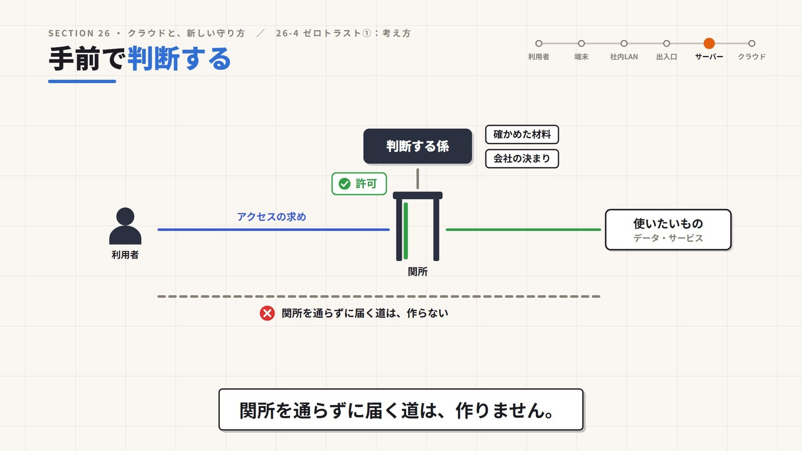

- **脆弱性の管理**：脆弱性1件ごとの番号が **CVE**、弱点の種類の一覧が **CWE**、日本語で読めるのが **JVN** です。**CVSS** は深刻さを0から10の点数にしますが、基本評価基準の点数は技術的な深刻さで、会社のリスクそのものではありません。直す順番は、深刻さ、外から届くか、攻撃に使われているか、影響の大きさで決めます。
- **安全な開発**：企画や設計からセキュリティを組み込む **セキュリティバイデザイン**、データの流れを描いて脅威を洗い出す **脅威モデリング**、使っている部品を追いかける **SBOM** などで、弱点を作り込まない、持ち込まないようにします。

---

## 13. 後半⑥：見張る ― ログ・SIEM・SOC

**ログ** は、いつ、何が起きたかの記録です。機器の時刻をそろえ（時刻同期）、ログを別のサーバーに集めて、書き換えられないように守ります。とはいえ、1日に何十万行もあるログを、人が全部読むことはできません。

**SIEM** は、いろいろなログを集めて形をそろえ、まとめて分析します。中心の働きが、複数のログを結び付けて攻撃の兆しを見つける **相関分析** です。

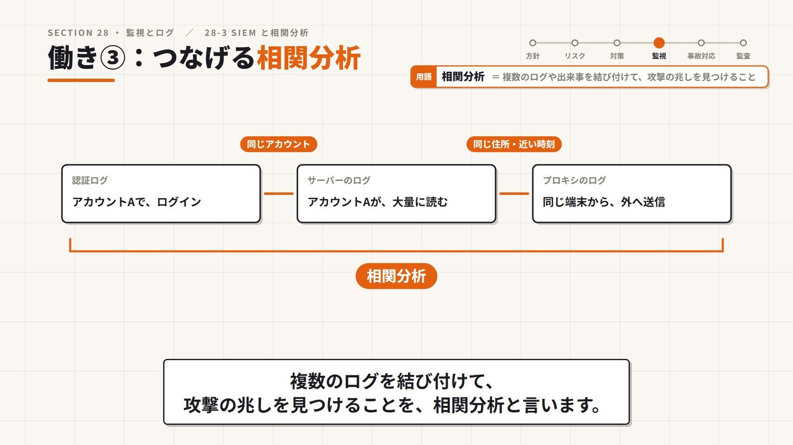

ログやアラートを見張り、攻撃を見つけて分析する組織が **SOC** です。アラートは、出しすぎも見逃しも減るように、規則を直し続けます。

---

## 14. 12月の事故を、通しで見る

ここからが、後半の物語の山場です。標的型メールから情報の持ち出しまでを、攻撃の道と、守る側の対応の両方からたどります。

### 攻撃の道：1通のメールから、持ち出しまで

| 日時 | 起きたこと | 守りは |
|---|---|---|
| 12月5日の夜中 | 外から、入口を調べる通信。管理の画面も、外からは開けない | ファイアウォールが拒否し、攻撃の型に合うリクエストは WAF が遮断（**働いた**） |
| 12月7日 10:12 | 経理の係のソラさんに、取引先に似たドメインから、請求書を装ったメール。添付は、マクロの入った文書 | 似せた別のドメインは、送信ドメイン認証に通ることがある。添付の検査でも見つからず |
| 10:31 | 添付が開かれ、マルウェアに感染（キーロガーの働きもあった） | EDR は知らせたが、重要度が低く、ほかの知らせに埋もれた |
| 感染のあと | 外の見なれない相手と、10分おきの通信（C&Cサーバーとの通信が疑われる） | 外への直接の通信は、ファイアウォールが拒否（**働いた**）。プロキシを通る通信は、外へ出ていた |
| 12月8日 23:41 | 感染したパソコンから、ソラさんのアカウントで、ファイルを置くサーバーにログイン。本人は、もう帰っていた | 3分後の、注文のデータベースへのログインは、権限が無く失敗（最小権限が**働いた**） |
| 同じ夜 | 経理のフォルダの312個のファイル（お客さん約1,200人分の名前と住所を含む）が読まれた | 読まれた記録は、サーバーの監査ログに残った |
| 12月9日 1:05 | 同じパソコンから、同じ相手へ、860メガバイトの送信 | 情報の持ち出しが疑われる |
| 1:50 | **SIEM** が、夜中のログインと外への大量の送信を結び付けて、アラート | 20分後、外の SOC のサービスから、ミナトさんに電話 |

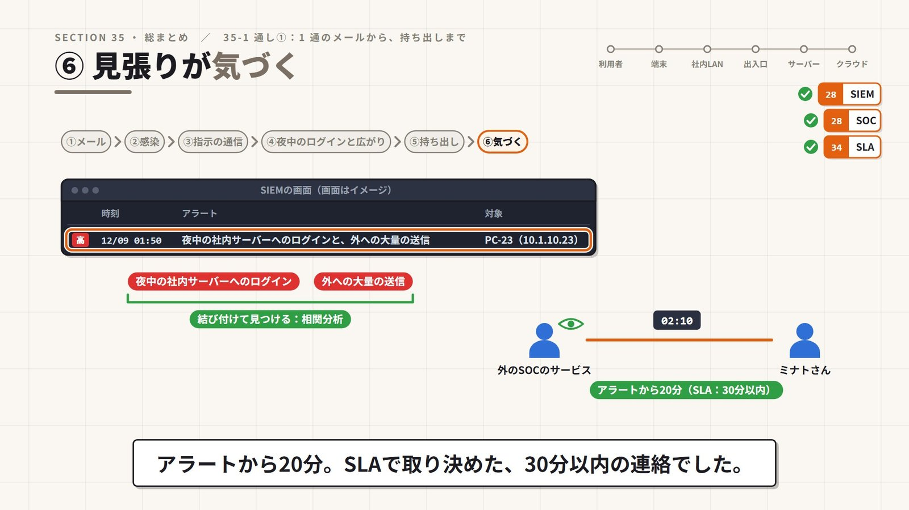

添付が開かれてからアラートまで、およそ **39時間**。開く前に止めるしくみも、開いたあとに気づくしくみも、足りませんでした。それでも、外への直接の通信の拒否と最小権限が途中で働き、見張りが夜中の動きを結び付けて気づきました。

### 守る側の対応：気づいてから、監査まで

夜中の電話から、前もって役割を決めてあった **CSIRT** が動きます。段階は、重なって進むこともあります。

1. **受け付けて、優先を決める**：記録の票を付け始め、ログで事実を確かめ、**トリアージ** でいちばん高い優先と判断。責任者へ知らせます（エスカレーション）。
2. **封じ込め**：パソコンを **端末隔離** で切り離し（電源は入れたまま）、出入口であの宛先への通信を止め、ソラさんのアカウントを一時止めます。お店とサーバーを止めるかは、責任者が決めます（このときは、止めずに見張りを強めて続けました）。
3. **証拠保全**：止めるのと同時に、証拠を変わらないように残します。2時40分に調査の専門の会社へ連絡し、2時50分にログの写しを取りました。
4. **速報**：全部が分かるのを待たずに、分かったことから知らせます。朝10時に警察に相談し、JPCERT/CC に報告し、メールで名前を使われた取引先にも連絡しました。
5. **調べて、影響の範囲を確かめる**：午後、調査の専門の会社の担当が **デジタルフォレンジックス** を始めました。消えやすいメモリを先に写し、次にディスクを丸ごと写します。受け渡しも、とぎれなく記録します（Chain of Custody）。12月16日に届いた結果では、影響が確かめられたのは、パソコン1台とアカウント1つ。持ち出されたのは、読み取りの記録がある312個のファイルと見ています。
6. **根絶と復旧**：パソコンを OS から入れ直し、パスワードを作り直します。サーバーは、夜中のログインより前のバックアップと比べました。書き換えは見つからず、2週間、見張りを強めて続けました。
7. **確定の報告**：原因、影響の範囲、取った対応、再発防止策などをまとめます。
8. **再発防止と監査**：メールの入口でマクロの入った添付を止め、文書のソフトが見なれないプログラムを動かしたら、高いアラートにします。決まりを作り、監査で確かめ、次の計画に生かします。

**個人情報の漏えいの報告**（2026年11月時点の個人情報保護法の決まり）：不正の目的が疑われる行為で、1,000人を超えるお客さんの個人データが、漏えいしたおそれがありました。サンプル商店は、報告が要る事態に当たると判断し、個人情報保護委員会に報告し、お客さん本人にも知らせました（漏えいが確かめられる前の、おそれの段階でも、報告が要ることがあります）。速報は事態を知ってから速やかに（ガイドラインでは、おおむね3〜5日以内が目安）、確報は知った日から原則30日以内、不正の目的によるおそれがある事態は60日以内です。

事故のときの考え方は、**事実と推定を分ける → 止めて、残す → 速報する → 範囲を確かめる → 取り除いて、戻す → 確定の報告をして、くり返さない** の順にまとめられます。「すぐに初期化して入れ直せば早い」と考えがちですが、証拠が消え、範囲も原因も調べにくくなります。止めることと残すことを、一緒に考えます。

---

## 15. 組織で守る：リスク・ISMS・法律・標準・監査

技術の守りは、組織の決まりと、くり返す管理の中で続いていきます。

### リスクマネジメント

情報資産を台帳に書き出し、**リスクアセスメント** で、リスクを洗い出し（特定）、大きさを見積もり（分析）、基準と比べて対応の優先を決めます（評価）。その結果をもとに、どう対応するか（**リスク対応**）を選びます。選び方は4つです。

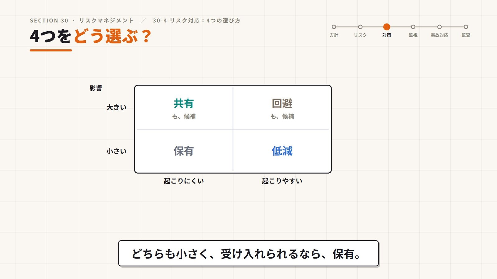

- **低減**：対策をして、下げる
- **回避**：その活動をやめる
- **共有**：保険や委託の契約などで、ほかの組織と分かち合う（分かち合っても、自分の会社の責任は残る）
- **保有**：小さく、受け入れられるなら、そのまま受け入れる

表の置き方は、考え始めるときの目安です。対策のあとに残るリスク（**残留リスク**）を受け入れるかは、リスク所有者が決めます。

### ISMS と管理策

**ISMS** は、組織として情報セキュリティを管理し、改善し続けるしくみで、計画・実行・点検・改善の **PDCA** をくり返します。

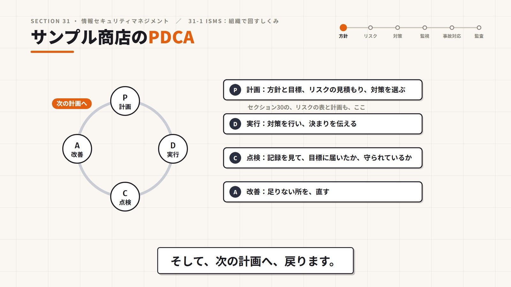

- 決まりは、なぜ守るのかの **基本方針**、何をするのかの **対策基準**、どうやって行うのかの **実施手順** の3つの段で整理できます。
- **管理策** は、規格の一覧では、組織的・人的・物理的・技術的の4つに分かれます。
- 大事な仕事を止めないか、早く再開するための **事業継続計画（BCP）** も、ここで考えます。

### 法律・標準・監査（2026年11月時点）

- **法律**：アクセス制御による制限を承諾なく破る行為などを禁じる **不正アクセス禁止法**、不正なプログラムなどの罪を定める **刑法**、個人情報の扱いと漏えいの報告を定める **個人情報保護法**、営業秘密を守る **不正競争防止法** など。法律は変わるので、公布と施行の日を公式の資料で確かめます（この記事は、法律の助言ではありません）。
- **標準**：ISMS の要求事項の規格 **ISO/IEC 27001**（日本の規格は JIS Q 27001）、管理策の手引きの ISO/IEC 27002、守りを6つの機能で整理する NIST の **CSF**、カードの情報を扱う事業者などが守る業界の基準 **PCI DSS** など。
- **監査**：独立した監査人が、IT のリスクへの対策が働いているかを確かめる **システム監査**、**情報セキュリティ監査**、仕事が正しく行われるよう業務に組み込む **内部統制** など。12月の事故のあとも、2月のシステム監査と3月の内部監査で、決まりどおりに運用されているかを確かめました。

---

## 16. 守りの地図：どの攻撃を、どこで止めるか

最後に、これまでの攻撃と守りを、会社の6つの場所の上に、1枚にまとめます。

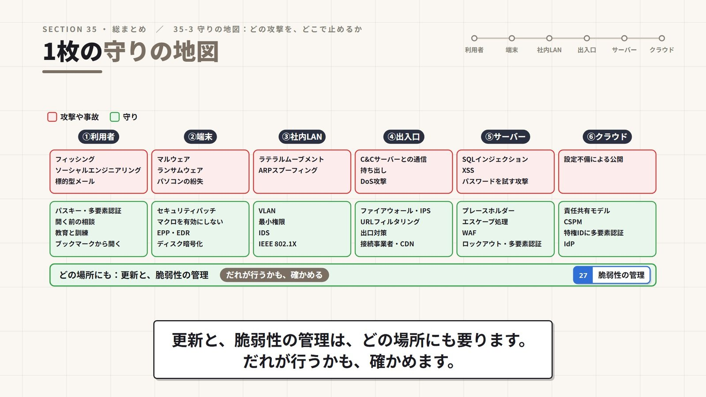

| 場所 | 来る攻撃 | 置く守り |
|---|---|---|
| 利用者 | フィッシング、ソーシャルエンジニアリング、標的型メール | パスキー・多要素認証、開く前の相談、教育と訓練、ブックマークから開く |
| 端末 | マルウェア、ランサムウェア、パソコンの紛失 | セキュリティパッチ、マクロを有効にしない、EPP・EDR、ディスク暗号化 |
| 社内LAN | ラテラルムーブメント、ARPスプーフィング | VLAN、最小権限、IDS、IEEE 802.1X |
| 出入口 | C&Cサーバーとの通信、持ち出し、DoS攻撃 | ファイアウォール・IPS、URLフィルタリング、出口対策、接続事業者・CDN |
| サーバー | SQLインジェクション、XSS、パスワードを試す攻撃 | プレースホルダー、エスケープ処理、WAF、ロックアウト・多要素認証 |
| クラウド | 設定不備による公開 | 責任共有モデル、CSPM、特権IDに多要素認証、IdP |

守りは、起こる前に防ぐ **予防**（ファイアウォール、更新、多要素認証）、起きたことに気づく **検知**（ログの見張り、EDR、IDS）、原因を取り除いて元に戻す **是正**（根絶、バックアップからの復元）をそろえて、重ねます。入口を固めても、メールの添付のように、許可した道を通って入ってくる攻撃があります。入られる前提で、中と出口にも、検知と是正の守りを置きます。場所だけで信用しないゼロトラストも、同じ向きの考え方です。

---

## 17. 情報処理安全確保支援士試験との関係

情報処理安全確保支援士試験は、経済産業省の国家試験で、運営は IPA（情報処理推進機構）です。2026年11月21日時点の案内では、次のとおりです。

- 2026年度から、試験会場のコンピュータで受ける **CBT** 方式。科目は **科目A-1・科目A-2・科目B** の3つ（以前の午前Ⅰ・午前Ⅱ・午後にあたります）
- 科目A-1 は50分で30問、科目A-2 は40分で25問。どちらも、4つの選択肢から1つを選ぶ多肢選択式
- 科目B は150分で、4問の中から2問を選び、文章などで答える記述式
- 合格には、受ける科目すべてで、原則60点以上が必要
- 問われる知識は **シラバス**（今は Ver.2.1）にまとめられている。科目A-2 で問われる用語の例は、追補版という別の文書にある。2027年度からは新しい試験制度に移る予定で、新しいシラバスは案の段階

講座が主に扱うのは、**科目A-2 と科目B の範囲の知識** です。科目A-1（共通の知識）は扱わず、過去問の解説や、科目B の記述式の演習も入っていません。用語としくみを理解したうえで、過去問や問題集と組み合わせて使うことを想定しています。

科目B の問題文には、会社の構成図やログが出てくることがあります。読むときは、次の3つの順で考えると、整理しやすくなります。

1. 登場する機器と、通信の向きを、自分で図にする
2. 出来事を、ログの並びではなく、書かれた時刻の順に並べる（機器の時刻のずれも確かめる）
3. どの性質が破られたかを言葉にする（のぞかれたなら機密性、書き換えられたなら完全性、止められたなら可用性）

試験の方式や日程は、変わることがあります。受ける前に、必ず IPA の公式のページで、最新の案内を確かめてください。

---

## 手元で確かめてみる（自分の機器・アカウントだけ）

講座では、多くのセクションの最後に、学んだしくみが実際の画面のどこに見えるかを、手元で確かめるレクチャーがあります。確かめるのは見ることが中心で、設定は変えず、何も壊しません。ファイルを使うときは、練習用のファイルや、その写しで試します。画面に出た値やパスワードは、人に送りません。次の4つは、見るだけで確かめられる例です。

- **証明書**：ブラウザのアドレス欄の鍵マークなどから、開いているサイトの証明書を表示し、発行者（認証局）、有効期間、名前を見る
- **メールの認証の結果**：自分に届いたメールのヘッダーを表示し、Authentication-Results に書かれた SPF・DKIM・DMARC の結果を見る（書き方や項目は、メールのサービスによって違います）
- **Cookie の属性**：自分がログインしているサイトで開発者ツールを開き、Cookie の Secure・HttpOnly・SameSite を見る
- **多要素認証**：自分のアカウントの設定で、多要素認証やパスキーが有効かを見る

画面の名前や場所は、ブラウザやサービスの版によって違います。

---

## まとめ

- 情報セキュリティは、**何を（情報資産）、何から（脅威）、どう守るか** で整理する。守る性質は、機密性・完全性・可用性を中心に考える
- 前半の基本のしくみ（暗号、署名と証明書、認証、アクセス制御、TLS、ファイアウォール）は、1回の買い物の中で、それぞれ別の所を守っている
- 攻撃の多くは、しくみの「確かめていない所」を突く。だから、しくみを先に学び、攻撃は「しくみ → 何が起きるか → 防ぎ方」の組で学ぶ
- 守りは場所ごとに置き、予防・検知・是正をそろえて重ねる。それでも起きる事故には、止めて、残して、知らせて、くり返さない
- 技術の守りは、リスクマネジメント、ISMS、法律、監査という、組織の一回りの中で続いていく

用語は、1つずつ覚えるより、「道のりのどこで、何を守る話か」と結び付けると、ぐっとつながりやすくなります。

---

## 動画講座のご案内とクーポン

この記事は、Udemy の動画講座 **[【動く図解でやさしく理解】情報処理安全確保支援士｜入門から試験範囲（科目A-2＆B）の情報セキュリティ知識を1講座で](https://www.udemy.com/course/information-security-overviewinformation-security-overview/?referralCode=683E768687FE030DED43)** の要点をまとめたものです。

講座では、この記事で駆け足にした内容を、動く図解で1つずつ追いかけます。記事の図は、すべて講座の動画の画面です。

- 全242本・約18時間10分、36のセクション。1本は平均4分半ほど
- 前半（セクション0〜11）だけでも、「暗号と認証の基本」として1つの講座のように完結する構成
- サンプル商店の物語を、最初から最後まで追いかける。いまどこを守る話かを、画面の右上に表示
- 攻撃は、しくみ・何が起きるか・防ぎ方を、必ず組で説明（攻撃の手順や、そのまま使える文字列は扱いません）
- 正式な用語は、画面の「用語カード」で表示。略語は、英語の正式名と日本語の名前もいっしょに
- 多くのセクションの最後に、自分の機器・アカウントだけで確かめる「確認」のレクチャー
- 法律・制度・規格は、2026年11月時点の内容
- 語りは合成音声（VOICEVOX:玄野武宏）です

### クーポン

| 種類 | クーポンURL | コード | 有効期限（日本時間） | 先着枠 |
|---|---|---|---|---|
| 無料クーポン1 | [無料クーポン1で受講する](https://www.udemy.com/course/information-security-overviewinformation-security-overview/?couponCode=5FDD6BA75C86136A16DE) | `5FDD6BA75C86136A16DE` | 2026年12月2日 20:57 まで | 先着10名 |
| 無料クーポン2 | [無料クーポン2で受講する](https://www.udemy.com/course/information-security-overviewinformation-security-overview/?couponCode=32640BF4256A21CFFC39) | `32640BF4256A21CFFC39` | 2026年12月28日 20:57 まで | 先着100名 |
| 割引クーポン（1,500円） | [割引クーポンで受講する](https://www.udemy.com/course/information-security-overviewinformation-security-overview/?couponCode=77A1BF9B1EFA85646CDD) | `77A1BF9B1EFA85646CDD` | 2026年12月28日 20:57 まで | 人数制限なし |

- 期限と先着枠は、2026年11月27日 20:58時点の情報です。無料クーポンは、期限か先着枠のどちらかに達した時点で終了します。
- 無料クーポンが終了している場合は、割引クーポンをご利用ください。登録の確定前に、Udemy 上の適用後の価格をご確認ください。

**よければ評価とコメントをお願いします！動画の改善の参考にさせていただきます！**

---

※ 記事中の図は、講座の動画の画面です（図とアニメーションは、AI がプログラムで作成しました）。記事の下書きに生成AIを使い、本文は、講座の台本と照らし、別のAIによる技術査読をして確認しています。例に使っているドメイン名（`example.jp` など）や IP アドレスは説明用の例で、登場する会社と人物は架空です。
