```html-embed
<p class="course-intro"><strong>この記事は、Udemyで公開中の動画講座『インターネットとWebシステムの全体像【動く図解でスッキリ理解】ネットワークの仕組みを基礎から実務の構成まで』の要点をまとめたものです。記事の末尾にクーポンを記載しているため、よろしければご利用ください。</strong></p>
<style>
  .course-intro { margin: 0; padding: 0.5rem; color: #b42323; background: #fff7f7; font: 1rem/1.7 system-ui, sans-serif; overflow-wrap: anywhere; }
  [data-theme="dark"] .course-intro { color: #ff9b9b; background: #2b1a1a; }
</style>
```

カフェの Wi-Fi につないだスマホで、ネットショップの商品リンクをタップする。ページが表示されるまで、およそ1秒です。

スマホは、Wi-Fi につないだときに、すでに住所（IPアドレス）をもらっています。タップしてからの1秒のあいだに、名前を引き、相手とのつながりを作り、暗号の準備をして、注文書（リクエスト）を送っています。注文書はいくつものルーターをバケツリレーで渡り、お店のサーバーに届き、返事が同じように戻ってきます。

この記事では、その道のりを **前半：シンプルな構成で、端から端まで**、**後半：ロードバランサー・CDN・クラウドを使う実務の構成と、会社のネットワーク** の順に、要点だけを手早くたどります。細かい手順や操作は省き、「全体像の地図」を持ち帰ってもらうことを目標にしています。

**この記事で分かること**

- Webページが表示されるまでに通る **5つの場所** と、仕組みを整理する **4つの層**
- IPアドレス・ルーター・NAT・TCP・DNS・HTTPS・HTTP が、それぞれ何を担当しているか
- ページが開かないときに、どの順番で確かめればよいか（切り分け）
- ロードバランサー・CDN・WAF・VPC など、実務の構成に出てくる部品の役目
- 会社のネットワーク（VLAN・DMZ・VPN・Active Directory）の全体像

**こんな方に向けています**

- IT やネットワークを、これから学び始める方
- 新人のエンジニアで、インフラやネットワークの全体像をつかみたい方
- 開発はしているけれど、通信の部分はブラックボックスになっている方
- 資格の勉強の前に、まず全体の地図がほしい方

---

## 0. 全体の地図：5つの場所と4つの層

まず、道のりに出てくる場所を5つに分けます。

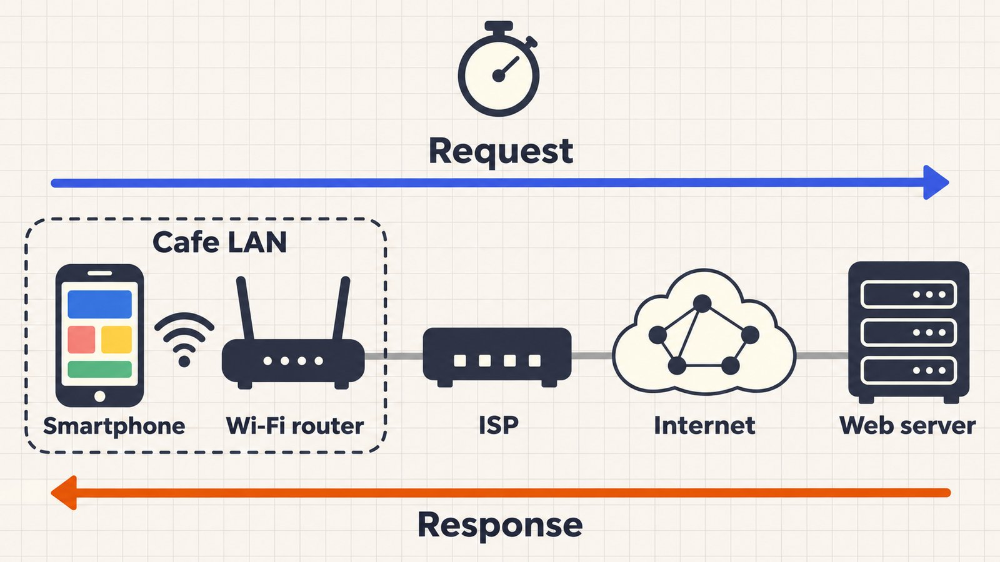

| 場所 | 役目 |
|---|---|
| スマホ（クライアント） | ページを頼む側。ブラウザがリクエストを作る |
| Wi-Fiルーター（カフェのLAN） | カフェの中のネットワーク（LAN）の出入り口 |
| ISP | インターネットへの接続を提供する事業者（プロバイダー） |
| インターネット | たくさんのネットワークがつながった、ネットワークの集まり |
| お店のWebサーバー | ページを返す側 |

そして、この道のりで働く仕組みを、**4つの層** に分けて考えます。これを **TCP/IPモデル** と言います。

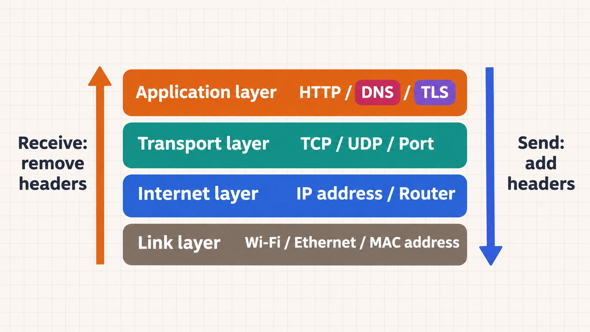

| 層 | ひとことで | 主な仕組み | この記事の章 |
|---|---|---|---|
| アプリケーション層 | やりとりする（中身） | HTTP、DNS、TLS | 6〜9 |
| トランスポート層 | 届ける（アプリまで） | TCP、UDP、ポート番号 | 5 |
| インターネット層 | 運ぶ（遠くまで） | IPアドレス、ルーター | 3〜4 |
| リンク層 | つなぐ（となりまで） | Wi-Fi、イーサネット、MACアドレス | 2 |

上の層は、下の層に運ぶことを任せて、自分の役目に集中します。この「分けて考える」見方が、後半の実務の構成や、トラブルのときの切り分けでも効いてきます。

---

## 1. インターネットの正体：ネットワークの集まり

インターネットは、1つの巨大な機械ではありません。家、会社、学校、ISP、データセンターなどの **たくさんのネットワークが、互いにつながったもの** です。

ページを頼む側を **クライアント**、返す側を **サーバー** と言います。両者は、あらかじめ決められた約束ごと（**プロトコル**）に従って、やりとりします。

実物の道のりは、こんな形をしています。家やお店では、光ファイバーの線が **ONU（光回線の終端装置）** に入り、そこから LAN ケーブルで Wi-Fi ルーターにつながります。

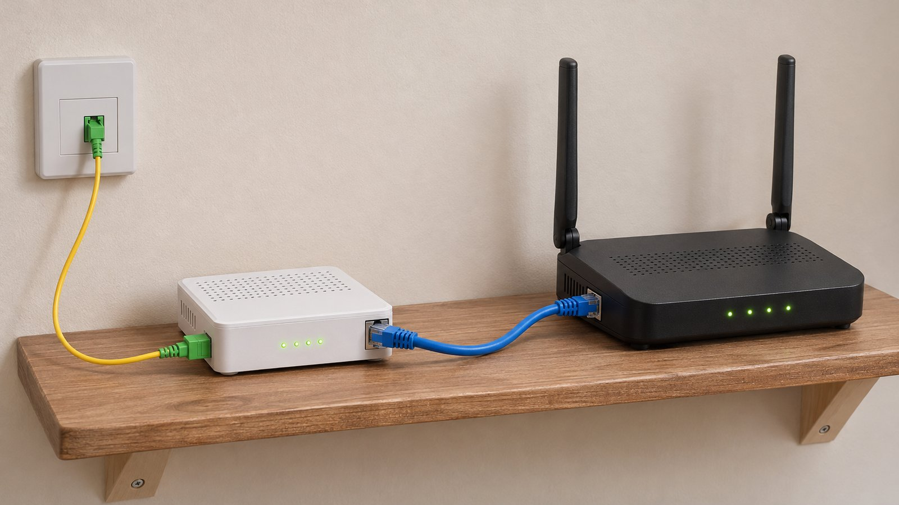

建物の外では、光ファイバーのケーブルが電柱を伝って ISP の設備へ向かいます。

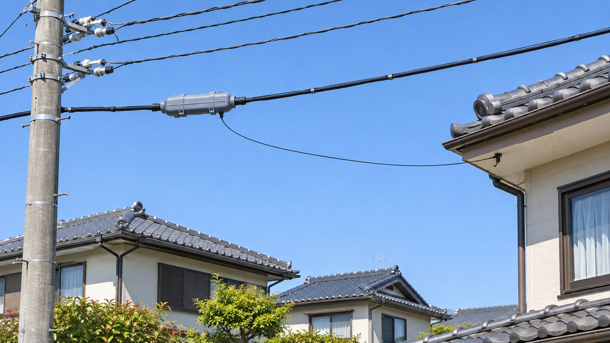

ISP の先は、ISP どうしの接続や海底ケーブルを通って、世界中のネットワークへつながっています（後半の17章）。そして終点のサーバーは、多くの場合データセンターに置かれています（後半の11章）。

---

## 2. つなぐ：LANの中（リンク層）

いちばん下のリンク層は、**となりの機器まで** データを届けます。有線ならイーサネット（LANケーブル）、無線なら Wi-Fi です。

機器を見分けるのは **MACアドレス** です。ネットワークの部品（NIC）ごとに付いた、機器の名札のような番号で、`00:1A:2B:3C:4D:5E` のように16進数で書きます。

LANの中でデータを配るのが **スイッチ** です。スイッチは、どのポートの先にどのMACアドレスの機器がいるかを **MACアドレステーブル** に覚え、届いたデータ（**フレーム**）の宛先が表にあれば、その機器がつながったポートにだけ送ります。宛先がまだ表にないときや、全員宛てのフレームは、受け取ったポート以外の、同じLANの中のすべてのポートに送ります。

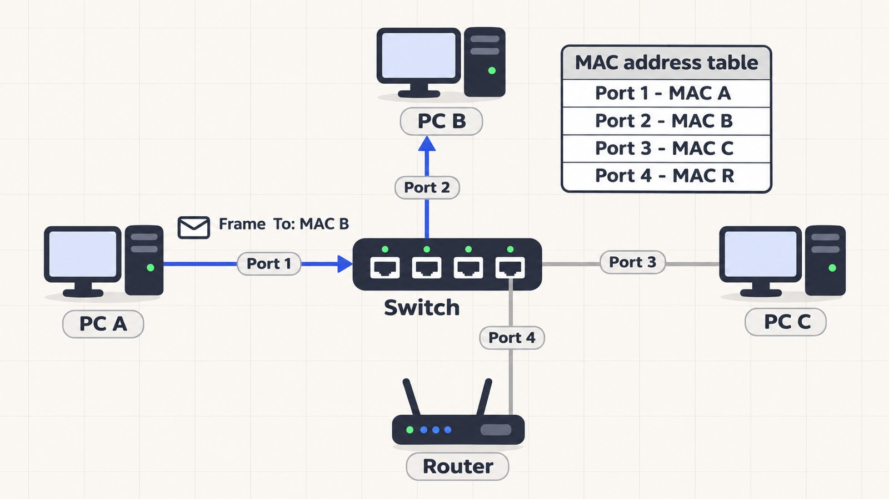

---

## 3. 住所：IPアドレス（インターネット層）

MACアドレスは「となり」までしか使えません。ネットワークをまたいで遠くの相手に届けるための住所が **IPアドレス** です。IPv4 では `192.168.1.10` のように、0〜255の数を4つ並べて書きます（全体で32ビット）。

- **ネットワーク部とホスト部**：IPアドレスは「どのネットワークか」と「その中のどの機器か」に分かれます。`192.168.1.10/24` なら、前の24ビット（`192.168.1`）がネットワーク部、最後の `10` がホスト部です。
- **プライベートとグローバル**：`192.168.x.x` などは、カフェや家の中だけで使う **プライベートIPアドレス**。インターネット上で通用するのは **グローバルIPアドレス** です。
- **DHCP**：Wi-Fiにつないだとき、スマホは **DHCP** で、自分のIPアドレス、出口（**デフォルトゲートウェイ**）、聞く先の **DNSサーバー** を教わります。もらえなかったとき、端末によっては `169.254` で始まる住所（リンクローカルアドレス）を自分で付けます。この住所が見えたら、DHCPで住所をもらえていない手がかりです。
- **ARP**：同じLANの中の相手のIPアドレスから、MACアドレスを調べる仕組みです。遠くへ送るときは、出口のルーターのMACアドレスを調べて、そこへ渡します。IPアドレスとMACアドレスの、橋渡し役です。

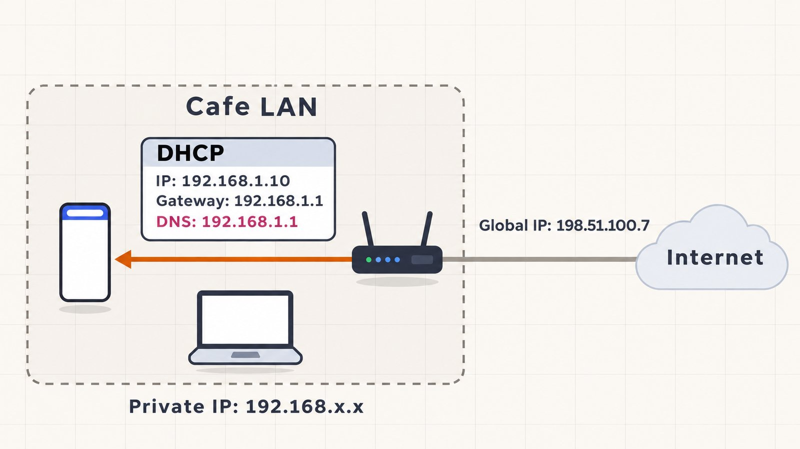

---

## 4. 運ぶ：ルーターとNAT

LANの外へ出るデータは、出口の **ルーター**（デフォルトゲートウェイ）に渡されます。

ルーターは、宛先のIPアドレスと **経路表（ルーティングテーブル）** を見て、**次にどのルーターへ渡すか**、つまり次の1歩だけを決めます（宛先が自分に直接つながったネットワークにあれば、その機器に直接届けます）。これを **ルーティング** と言います。インターネットは、このバケツリレーの連続で、最後のルーターがお店のサーバーに届けます。

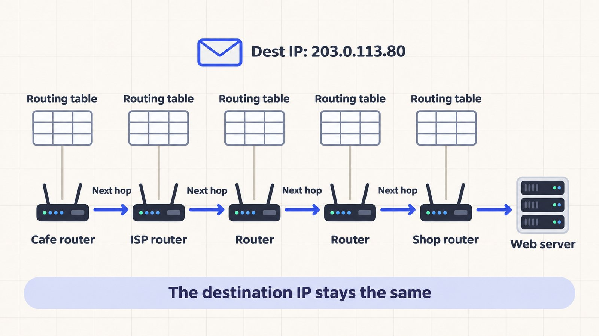

ポイントは2つです。

- 区間ごとにフレームの宛先（MACアドレス）は書き直されますが、行きの **宛先のIPアドレス（お店のサーバー）は最後まで変わりません**。（帰りは、カフェのルーターが下のNAPTで、宛先をスマホの住所に戻します）
- 行きと帰りで、通るルーターが同じとは限りません。

もう1つ大事なのが **NAT** です。プライベートIPアドレスのままではインターネットに出られないので、カフェのルーターが送り主の住所をグローバルIPアドレスに書き換えます。家庭やお店では、**ポート番号**（5章）も一緒に書き換えて、複数の機器が1つのグローバルIPアドレスを共有する **NAPT** が使われます。返事が戻ってきたら、表を見て元の機器へ戻します。

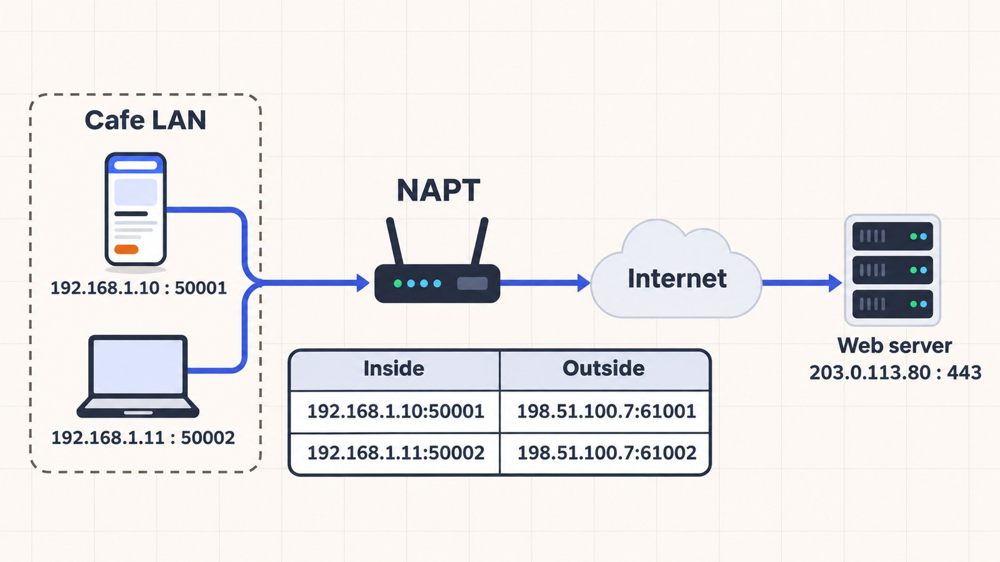

相手まで届くかは `ping`、途中のどのルーターを通っているかは `tracert`（macOS や Linux では `traceroute`）で調べられます。ただし、返事をしないルーターやサーバーもあるので、答えが無くても届いていないとは限りません。逆に `ping` が届いても、Webのつながりや暗号の準備で失敗することがあります（それはブラウザや開発者ツールで確かめます）。

---

## 5. 届ける：TCPとポート（トランスポート層）

IPアドレスで届くのは「機器」までです。機器の中の **どのアプリ宛てか** を見分けるのが **ポート番号** です。HTTPSは `443`、HTTPは `80`、DNSは `53` が代表で、スマホの側は、その場で選んだ使い捨ての番号（**エフェメラルポート**）を使います。

**TCP** は、データを **順番どおり、確実に** 届けるための仕組みです。届いたことを確認し、届かなかった分は送り直します。通信を始める前に、**3ウェイハンドシェイク**（SYN → SYN+ACK → ACK）で、つながりを作ります。

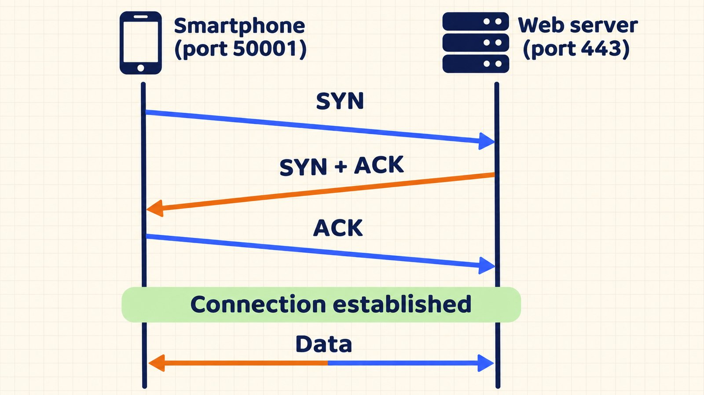

確認の手間を省いて速さを優先するのが **UDP** です。名前を引くDNSや、動画・通話、HTTP/3（後半の14章）などで使われます。

送るときは、上の層から順にヘッダーを付けて包み、受け取る側は下から順に開けます。これを **カプセル化** と言います。HTTPの注文書が、TLSの暗号、TCP、IP、フレームの順に包まれていく「封筒の中の封筒」です。

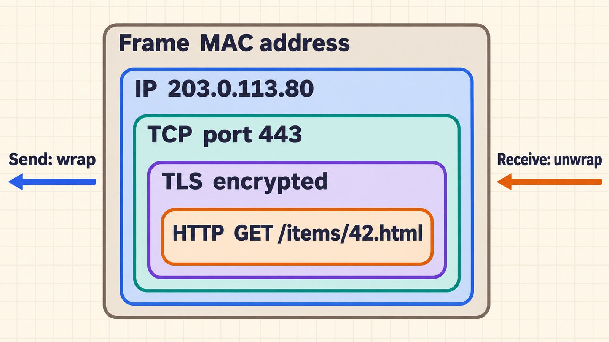

---

## 6. 名前：DNS

`https://shop.example.jp/items/42.html` というURLは、3つに分けて読めます。

| 部分 | 例 | 意味 |
|---|---|---|
| スキーム | `https` | やりとりの方法 |
| ホスト名 | `shop.example.jp` | 相手の名前 |
| パス | `/items/42.html` | 相手の中の、どのファイル（処理）か |

ところが、通信に必要なのは名前ではなくIPアドレスです。名前をIPアドレスに変えることを **名前解決** と言い、これを担うのが **DNS** です。

スマホはWi-Fiルーターに聞き、ルーターは多くの場合、ISPの **DNSリゾルバー** に取り次ぎます。リゾルバーは、**ルートサーバー → `.jp` のサーバー → `example.jp` のサーバー** と順にたどり、`203.0.113.80` という答えを持ち帰ります。

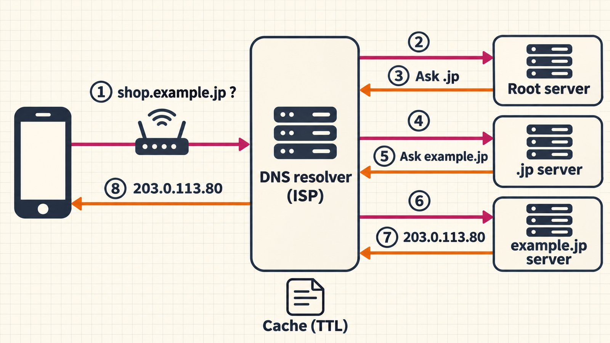

一度引いた答えは、**TTL**（有効な時間）のあいだ **キャッシュ** されるので、毎回この旅をするわけではありません。名前を引けるかは `nslookup` で確かめられます。

---

## 7. 守る：HTTPS

途中の経路には、悪意のある人がいるかもしれません。通信には3つの危険があります。

- **盗聴**：中身を盗み見られる
- **改ざん**：中身を書き換えられる
- **なりすまし**：偽のお店に、本物のふりをされる

これを防ぐのが **HTTPS**（HTTP over TLS）です。仕組みの要点は次のとおりです。

1. **共通鍵と公開鍵**：同じ鍵で暗号にして開ける **共通鍵** は速い代わりに、鍵を安全に渡すのが難しい。そこで、公開してよい鍵と秘密の鍵の組を使う **公開鍵** の仕組みを使って、安全に共通鍵を用意します。
2. **証明書と認証局**：サーバーは、**認証局（CA）** が署名した **証明書** を見せます。認証局は、申し込んだ人がその名前を本当に管理しているかを確かめてから署名します。ブラウザは署名をたどり、さらにサーバーが証明書と組の秘密鍵を持っていることを確かめて、本物の `shop.example.jp` かを確かめます（**サーバー認証**）。
3. **TLSハンドシェイク**（今の主流の TLS 1.3 の場合）：最初のやりとりで、両方が同じ共通鍵を作ります。その鍵で守られた中で、サーバーが証明書を送り、ブラウザがサーバー認証をします。準備が済んだら、以降の HTTP のやりとりを暗号にします。

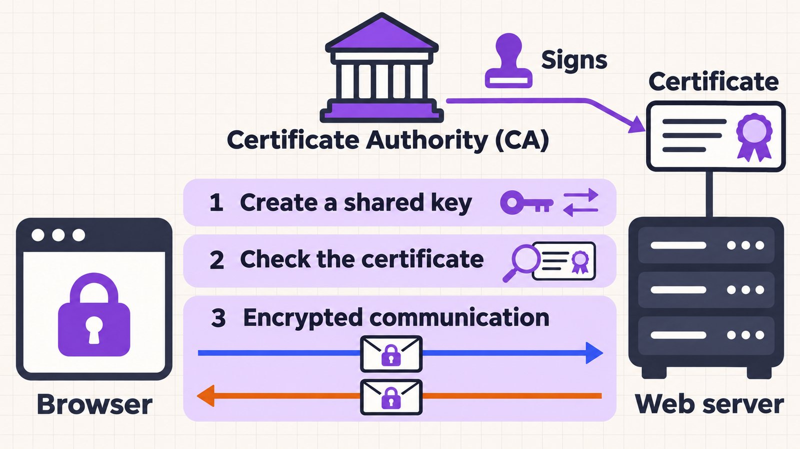

アドレスバーの鍵マーク（ブラウザによっては別の形の印）が示すのは、「通信が TLS で暗号になっていて、相手が、アドレスバーのホスト名に合う有効な証明書と、その組の秘密鍵を持っている」ことです。**そのサイトが信用できるお店かどうかまでは保証しません**。偽サイトでも鍵マークは付きます。

---

## 8. 話す：HTTP

いよいよ注文書です。ブラウザは `GET /items/42.html` という **リクエスト** を送り、サーバーは **レスポンス** を返します。

- **メソッド**：サーバーに何をしてほしいか。ページや検索結果を取得するなら `GET`（検索の言葉はURLに付けて送れる）、注文やログインのように送った内容を処理してほしいなら `POST`
- **ステータスコード**：結果。`200 OK`（成功）、`301`（移動した）、`404 Not Found`（無い）、`500`（サーバーの中の失敗）など。**400番台はリクエストを受け付けられなかった（ページが無い、許可されていない、など）、500番台はサーバーの側で処理に失敗した** という目安です。400番台でも、サイトの側のリンクの誤りなどが原因のことがあります
- **ヘッダー**：添え書き。`Host`（どのサイト宛てか）、`Content-Type`（中身の種類）など

シンプルな構成では、URLのパスは、サーバーの中の **公開用のフォルダ** のファイルの場所に対応します。`/items/42.html` なら、公開用フォルダの `items` の中の `42.html` を返します。ファイルが無ければ `404` です。

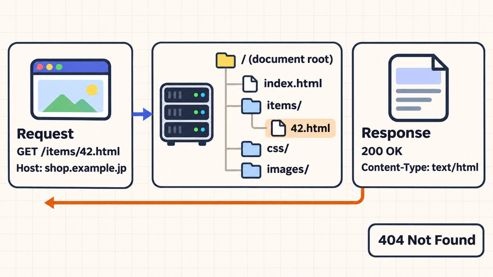

HTTPは、1回ごとのやりとりを **覚えていない** 仕組みです。そこで、サーバーが渡した小さな札（**Cookie**）をブラウザが保存し、次からは、そのサイトへのリクエストに自動で添えて送ります。サーバーは、その札を手がかりに、「ログイン中」や「カートの中身」といった状態を引き継ぎます。

ブラウザの **開発者ツール**（Chrome なら F12 の Network タブ）を開くと、実際のリクエストとレスポンスを、自分の目で見られます。

---

## 9. 表示する：ブラウザ

HTMLを受け取ったブラウザは、中身を読んで **部品の木（DOM）** を作り、CSSで見た目を当てはめ、配置を決めて、画面を描きます。この流れを **レンダリング** と言います。

HTMLの中には、CSS、JavaScript、画像などの **ほかのファイルの指定** があります。ブラウザはそれらも並列に頼むので、**1つのページを表示するために、何十回も通信している** のがふつうです。

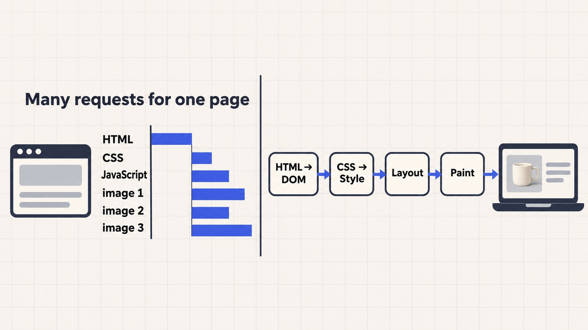

---

## 10. 前半のまとめ：タップから表示まで、通しで見る

ここまでの仕組みをつなげると、タップしてからの1秒で起きていることは、次のようになります（住所は、Wi-Fiにつないだときに、DHCPで `192.168.1.10` と、ゲートウェイ、DNSサーバーを教わっています）。

1. **名前を引く**：スマホがカフェのルーターに聞き、ルーターがISPのリゾルバーに取り次いで、`shop.example.jp` を `203.0.113.80` に変える
2. **つながりを作る**：お店のサーバーの `443` 番へ `SYN` を送り、TCPの3ウェイハンドシェイク
3. **暗号の準備**：TLSハンドシェイクで、共通鍵を作り、証明書を確かめる
4. **注文書を包む**：`GET /items/42.html` を、TLS・TCP・IP・フレームの順に包む（宛先MACはARPで調べたルーター）
5. **LANを出る**：ルーターがNAPTで、送り主の住所と番号を外向きに書き換える
6. **インターネットを渡る**：ルーターからルーターへのバケツリレー（ルーティング）
7. **サーバーが開ける**：下の層から順に開け、パスから `42.html` を探して `200 OK` を返す
8. **返事が帰る**：同じように渡り、カフェのルーターが元のスマホの住所と番号に戻す
9. **画面を作る**：HTMLを読み、CSSや画像を並列に頼み、画面を描く

お店のサーバー宛てのパケットは、2 の最初の `SYN` から、注文書と同じように、5〜6 の道（カフェのルーターのNAPTと、インターネットのバケツリレー）を通って届きます。

4つの層で整理し直すと、こうなります。

| 層 | 相手を見分けるもの | 主な機器・仕組み | データの呼び名（PDU） |
|---|---|---|---|
| アプリケーション層 | URL・ホスト名 | HTTP、DNS、TLS | メッセージ |
| トランスポート層 | ポート番号 | TCP、UDP | セグメント（TCP） |
| インターネット層 | IPアドレス | ルーター、NAT | パケット |
| リンク層 | MACアドレス | スイッチ、Wi-Fi、ARP（IPアドレスからMACアドレスを調べる橋渡し役） | フレーム |

### ページが開かないときの切り分け（基本）

原因の場所を、範囲をしぼって見つけることを **切り分け** と言います。コツは **下の層から、近い所から、1つずつ** です。

1. ほかのサイトは開くか（自分の側か、お店の側か）
2. Wi-Fiにつながっているか
3. 住所をもらえているか（`169.254` で始まる住所なら、DHCPで住所をもらえていない手がかり）
4. ルーターまで届くか（`ping`。相手まで届くかを確かめることを **疎通確認** と言う）
5. 名前を引けるか（`nslookup`）
6. お店まで届くか（`ping`・`tracert`。ただし ping に答えないサーバーも多い）
7. つながり・暗号・返事は正しいか（ブラウザのエラー、開発者ツール、ステータスコード。400番台なら、ページが無い・許可されていないなど受け付けられなかった理由を、500番台ならお店の側を疑う）

---

## 11. 後半：1台のサーバーの限界と、サーバーの中

前半の終点は「サーバー1台」でした。実務では、この1台に4つの悩みが出ます。

- **増える**：アクセスが増えると、1台では受けきれない
- **止まる**：1台が止まると、お店ごと止まる
- **遅い**：遠くの利用者には、時間がかかる
- **狙われる**：インターネットに出している以上、攻撃が来る

後半は、この4つに応える部品を、道のりに足していきます。

その前に、サーバーの中を見てみます。データセンターのラックに並ぶ物理サーバーの上では、多くの場合 **ハイパーバイザー**（VMware ESXi など）が動き、1台の物理サーバーを、何台もの **仮想マシン（VM）** に分けて使っています。VMへの通信は、物理サーバーの中の **仮想スイッチ** を通って届きます。


---

## 12. 増やす：ロードバランサーと冗長化

1台を強くする代わりに、**台数を増やして並べる**（スケールアウト）のが、実務の基本です。

並べたサーバーの手前に立って、リクエストを振り分けるのが **ロードバランサー** です。ロードバランサーは **ヘルスチェック** で各サーバーが動いているかを確かめ、止まったと分かったサーバーを振り分け先から外します（止まってから外すまでの短いあいだは、失敗するリクエストもあります）。

建物ごと止まることに備えるなら、離れた2つの拠点（たとえば東京と大阪のデータセンター）に、入口とサーバーをそれぞれ用意し、データももう一方へ写し続けます。片方が止まったら、DNSの答えを残る拠点の住所に切り替えて案内します（古い答えがキャッシュされているあいだ〈TTL〉は、止まった拠点へ行こうとする人もいます）。このように、予備を用意して止まらないようにすることを **冗長化** と言います。

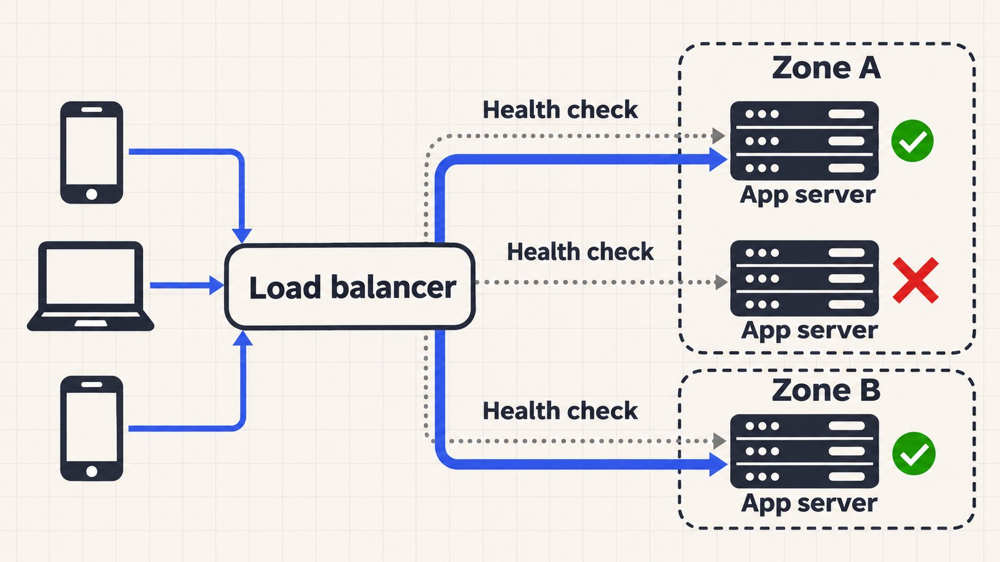

---

## 13. 分ける：Web・アプリケーション・データベースの3層

在庫や値段、ログインした人のカートが入る商品ページは、見る人や見る時間によって変わるので、用意したファイルを返すだけでは足りません。実務では、役目を3つに分けます。

- **Webサーバー**：リクエストを受け、画像やCSSなどの静的なファイルを返す。ページを作る必要があれば、後ろのアプリケーションサーバーに頼む
- **アプリケーションサーバー**：プログラムで、その場でページ（HTML）を組み立てる
- **データベース**：商品・在庫・注文などのデータを持つ。アプリは **SQL** で問い合わせる

このとき、URLのパスはファイルではなく **プログラムの処理** を指すことがあります。サーバーの手前に立って代わりに受け付ける **リバースプロキシ** や、暗号をどこでほどくか（**TLS終端**）、画面ではなくデータだけを返す **API と JSON** も、この構成の大事な部品です。

---

## 14. 速くする：キャッシュとCDN

速くするコツは、**近くに写しを置く** ことです。

- **ブラウザのキャッシュ**：一度受け取った画像やCSSの写しを、スマホの中に残しておく。有効期限のあいだは、そのまま使う。期限が過ぎても、サーバーに聞いて「変わっていません」（`304`）と返れば、手元の写しを使う
- **CDN**：利用者の近くにある **エッジサーバー** に、お店のファイルの写しを置く。お店の名前を引くと、DNSが **CNAME** でCDNの名前に向け、CDNのDNSが近くのエッジの住所を答える

エッジに使える写しがあれば、その場で返します（**キャッシュヒット**）。写しが無ければ、エッジがお店のサーバー（**オリジン**）まで取りに行きます。どれを、どれだけ残すかは `Cache-Control` などで決めます。画像やCSSのような **静的コンテンツ** は写しを残しやすく、在庫や値段、カートの中身が入る商品ページのような **動的コンテンツ** は、この講座の例ではエッジに写しを残さず、オリジンへ取り次ぎます。

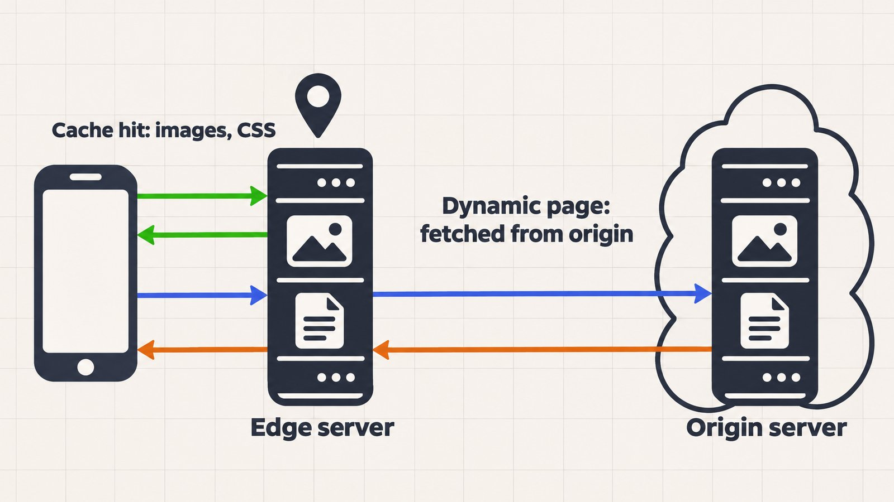

通信そのものも速くなっています。**HTTP/2** は1つのつながりで何本ものやりとりを同時に流し、**HTTP/3** は UDP の上の **QUIC** で、つながりと暗号の準備を一度に済ませます。

---

## 15. 守る：実務のセキュリティ

- **ファイアウォール**：IPアドレスやポート番号の規則で、通してよい通信だけを通す
- **WAF**：HTTPの中身まで調べて、SQLインジェクションなどの攻撃を止める
- **DDoS対策**：大量の通信で押しつぶす攻撃を、手前で受け止める
- **外から届く場所・届かない場所**：外に見せるのは入口（ロードバランサーなど）だけにし、アプリやデータベースは外から直接届かない場所に置く
- **管理用の入口**：運用担当がサーバーに入る道は、**VPN** でつなぎ、**多要素認証** で本人を確かめ、専用の **踏み台** を通る形に限る（サーバーの管理の口は、踏み台からだけ受け付ける）

---

## 16. クラウドの上のネットワーク

**クラウド** は、サーバーやネットワークを自分で買って持つ（**オンプレミス**）代わりに、事業者の設備を、**自分の操作ですぐに使い、使った分だけ払う** 形です。代表は AWS、Microsoft Azure、Google Cloud で、同じ役目の部品でも呼び名が少しずつ違います。どこまでを任せるかで、**IaaS・PaaS・SaaS** と呼び分けます。

クラウドの中には、自分専用のネットワーク **VPC** を作り、**サブネット** に分けます。

- **パブリックサブネット**：**インターネットゲートウェイ** への経路がある区画。外と直接やりとりする機器（ロードバランサーなど）には、公開用のIPアドレスと、通してよい通信を決める設定を付ける
- **プライベートサブネット**：外から直接は届かない区画。アプリケーションサーバーやデータベースを置く
- **NATゲートウェイ**：プライベートサブネットのサーバーが外へ出るための出口。通るのは、**中から始めた通信と、その返事** だけ
- **リージョンとゾーン**：リージョンは地域、ゾーン（アベイラビリティゾーン）はその中の独立した設備。ゾーンに分けて置くのが冗長化の基本
- **用意された部品**：ロードバランサーやデータベースを、事業者が運用する形で借りられる（マネージドサービス）

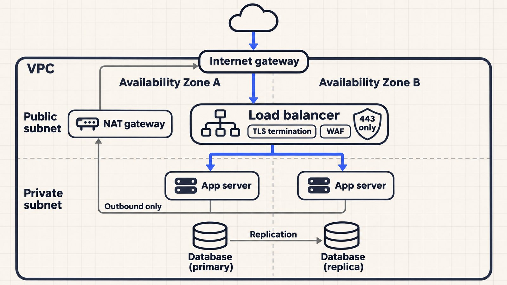

---

## 17. インターネットの裏側

- **ASとBGP**：ISPなど、1つの方針で運用されるネットワークのまとまりを **AS** と言います。AS どうしは **BGP** で「どこへの道を知っているか」を伝え合い、経路を決めます
- **IXと海底ケーブル**：ISPどうしは、**IX**（インターネットエクスチェンジ）でまとめてつながります。国をまたぐ通信のほとんどは、**海底ケーブル** を通ります
- **IPv6のいま**：IPv4の住所が足りなくなったため、128ビットの **IPv6** への移行が進んでいます
- **モバイル回線**：スマホの4G/5Gは、基地局から携帯電話会社のネットワークを通ってインターネットへ出ます


---

## 18. 状態を持つ・つながり続ける

- **セッションの置き場所**：サーバーが何台もあると、どのサーバーに届いても同じ「ログイン中」でいられるように、状態を **セッションストア** などの共通の場所に置きます
- **トークン**：本人確認のあとに受け取る、利用者や許された操作を示すデータをリクエストに添える方式。APIでは、添えられた **アクセストークン** が有効か、その操作が許されているかを、サーバーが確かめます
- **WebSocket**：チャットや通知のように、サーバーからも話しかけたい場面で、つながりを開いたままにする仕組み

---

## 19. 総まとめ：同じリクエストを、実務の構成で通す

前半と同じ「42番の商品ページを開く」を、実務の構成で通すと、こうなります。

1. 名前を引くと、お店のDNSは **CNAME** でCDNの名前を返し、CDNのDNSが近くの **エッジ** の住所を答える
2. スマホはエッジと、暗号のつながりを作る（HTTP/3なら、QUICで、つながりと暗号の準備を一度に）
3. 商品ページは、この例ではエッジに写しを残さないので、エッジが **別の HTTPS のつながり** で **オリジン** へ取りに行く（**IX** を通り、**BGP** が選んだ道で、お店のクラウドへ）
4. お店の **VPC** には **インターネットゲートウェイ** から入り、パブリックサブネットの **ロードバランサー** が受ける（**セキュリティグループ** で `443` 番だけを通す）
5. エッジから届いた暗号を入口でほどき（**TLS終端**）、**WAF** が中身を調べ、**ヘルスチェック** で動いていると分かっているサーバーに振り分ける
6. プライベートサブネットの **アプリケーションサーバー** が、**セッションストア** からカートの中身を、**データベース** から値段と在庫を取り出し、HTMLを組み立てる
7. サーバーもデータベースも **2つのゾーン** に分けて置き、データベースの変更は **レプリケーション** で隣のゾーンに写し続ける
8. 返事はロードバランサー、エッジを通ってスマホへ。画像やCSSは、エッジの写しからすぐ返る（キャッシュヒット）

部品は増えても、**名前を引き、つながり、暗号を準備して、頼んで受け取る** という流れは、前半とまったく同じです。

### OSI参照モデルとの対応

実務では、通信を7つの層に分ける **OSI参照モデル** の番号で話すことも多いです。

| この記事の4つの層 | OSI参照モデル | 呼び名 | 例 |
|---|---|---|---|
| アプリケーション層 | アプリケーション層・プレゼンテーション層・セッション層 | L7・L6・L5 | HTTP、DNS／L7のロードバランサー、WAF |
| トランスポート層 | トランスポート層 | L4 | TCP、UDP／L4のロードバランサー |
| インターネット層 | ネットワーク層 | L3 | IP／ルーター |
| リンク層 | データリンク層・物理層 | L2・L1 | イーサネット、Wi-Fi／L2スイッチ |

実際のプロトコルは7つにきれいには分かれません（TLSのように、どの層とも言い切れないものもあります）。実務でよく使うのは **L2・L3・L4・L7** の4つで、「L2まではつながっている。L3の経路を確かめよう」のように、話をそろえる物差しとして使います。

### 実務の切り分け

部品が多くても、範囲をしぼる考え方は同じです。手がかりになるのは次の3つです。

- **ログ**：各部品が書き残す記録。リクエストと返事の記録は **アクセスログ**。入口に500番台が並んでいれば奥を、WAFが止めた記録が多ければ誤検知を疑う
- **監視**：動いているか、返事の速さ、CPUの使用率などをふだんから見張り、おかしくなったら **アラート** で知らせる
- **パケットキャプチャ**：流れているパケットをそのまま記録して調べる。ただし暗号の中身は読めない

直したら、何が起きてどう直したかを残し、**再発防止策** まで考えるのが実務です。

---

## 20. 会社のネットワーク

最後に、お店の会社で働く社員の側から見たネットワークです。

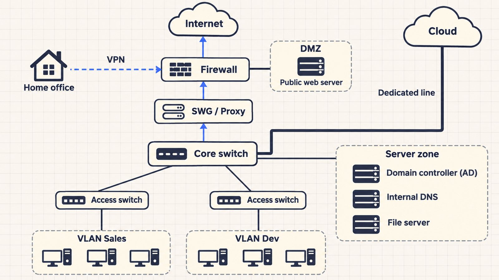

- **社内LANとVLAN**：スイッチを階層に組み（コアスイッチとアクセススイッチ）、**VLAN** で部署ごとにネットワークを論理的に分ける
- **ファイアウォールとDMZ**：外に公開するサーバーは、社内とは別の区画 **DMZ** に置く。インターネットからは、DMZで公開しているサービス宛ての通信だけを受け付け、外から社内へは通さない。DMZのサーバーから社内へは、決めた相手への、決めた通信だけを通す
- **プロキシとSWG**：社員が外のサイトを見るときは、プロキシが代わりに外へ取りに行く。**SWG**（セキュアWebゲートウェイ）でHTTPSの中身まで検査するときは、パソコンとSWG、SWGと外のサイトで、別々に暗号の通信をする（パソコンには、SWGの証明書を信頼する設定を入れておく）
- **内部DNS**：社内のサーバーの名前を答え、外の名前は外のDNSに聞いてくれる
- **Active Directory**：社員のアカウントと所属グループを管理し、ログオンのときの本人確認を担う。ファイルサーバーなどの各サーバーは、社員の所属グループとフォルダごとの設定を照らし合わせて、「営業部のフォルダは開けるが、開発部のフォルダは開けない」といった **権限** を判断する
- **外とつなぐ**：別の拠点やクラウドとは **専用線** や **VPN** で、自宅からは **VPN** でつなぎ、会社にいるのと同じように社内のシステムを使う

社員が外のサイトを開いた通信も、会社の出口を出れば、前半で追いかけたのと同じ道のりをたどります。

---

## まとめ

- Wi-Fiにつないだときに住所をもらっておき、タップしてからの1秒で、**名前を引く → つながる → 暗号を準備する → 頼む → 受け取って描く** の流れ
- その流れは、**つなぐ・運ぶ・届ける・やりとりする** の4つの層で整理できる
- 実務の構成は、**増える・止まる・遅い・狙われる** に応える部品（ロードバランサー、CDN、WAF、クラウドのVPCなど）を、同じ道のりに足したもの
- 困ったときは、**下の層から、近い所から、1つずつ** 確かめる

全体の地図があると、新しい技術や用語に出会っても「道のりのどこの話か」が分かるようになり、ぐっと理解しやすくなります。

---

## 動画講座のご案内と無料クーポン

この記事は、Udemyの動画講座 **[インターネットとWebシステムの全体像【動く図解でスッキリ理解】ネットワークの仕組みを基礎から実務の構成まで](https://www.udemy.com/course/internet-web-system-overview/?referralCode=C9D268420E264EC38B87)** の要点をまとめたものです。

講座では、この記事で駆け足にした内容を、動く図解で1つずつ追いかけます。

- 全93本・約4時間38分。前半だけでも1つの講座として完結する構成
- カフェのスマホから商品ページを開く1つの例を、最初から最後まで追いかける
- 光回線の機器、電柱、海底ケーブル、データセンターなど、実物のイメージも交えて解説
- `ping`・`tracert`・`nslookup`・開発者ツールで、自分の環境で確かめる方法も紹介
- 語りは合成音声（VOICEVOX:玄野武宏）です

### クーポン

| 種類 | クーポンURL | コード | 有効期限（日本時間） | 先着枠 |
|---|---|---|---|---|
| 無料クーポン1 | [無料クーポン1で受講する](https://www.udemy.com/course/internet-web-system-overview/?couponCode=2DEF00F4858110F52417) | `2DEF00F4858110F52417` | 2026年11月26日 19:17 まで | 先着10名 |
| 無料クーポン2 | [無料クーポン2で受講する](https://www.udemy.com/course/internet-web-system-overview/?couponCode=6E48FC0380F589C574C5) | `6E48FC0380F589C574C5` | 2026年12月22日 20:44 まで | 先着100名 |
| 割引クーポン（1,500円） | [割引クーポンで受講する](https://www.udemy.com/course/internet-web-system-overview/?couponCode=AA08F8D0148C064E4415) | `AA08F8D0148C064E4415` | 2026年12月22日 20:45 まで | 上限なし |

- 期限と先着枠は、2026年11月21日時点の情報です。無料クーポンは、期限か先着枠のどちらかに達した時点で終了します。
- 無料クーポンが終了している場合は、割引クーポンをご利用ください。

**よければ評価とコメントをお願いします！動画の改善の参考にさせていただきます！**

---

※ 記事中の図とイメージ画像は、生成AI（ChatGPT Images）で作成しました。本文と図は、講座の台本と照らし、別のAIによる技術査読をして確認しています。例に使っているドメイン名（`example.jp`）や、グローバルIPアドレスの代わりに使ったIPv4アドレス（`203.0.113.80`、`198.51.100.7`）は、説明用に予約された例で、実際にはつながりません。
