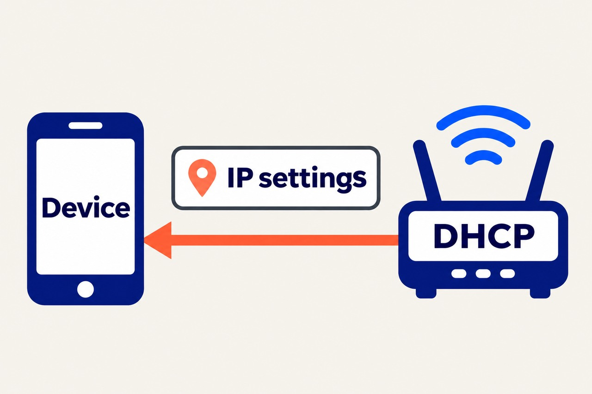
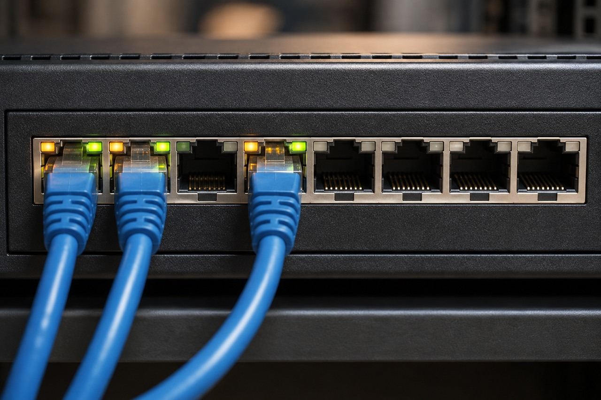
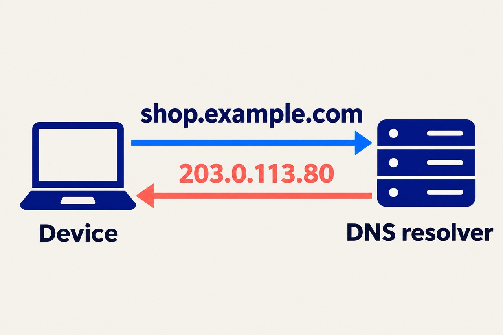
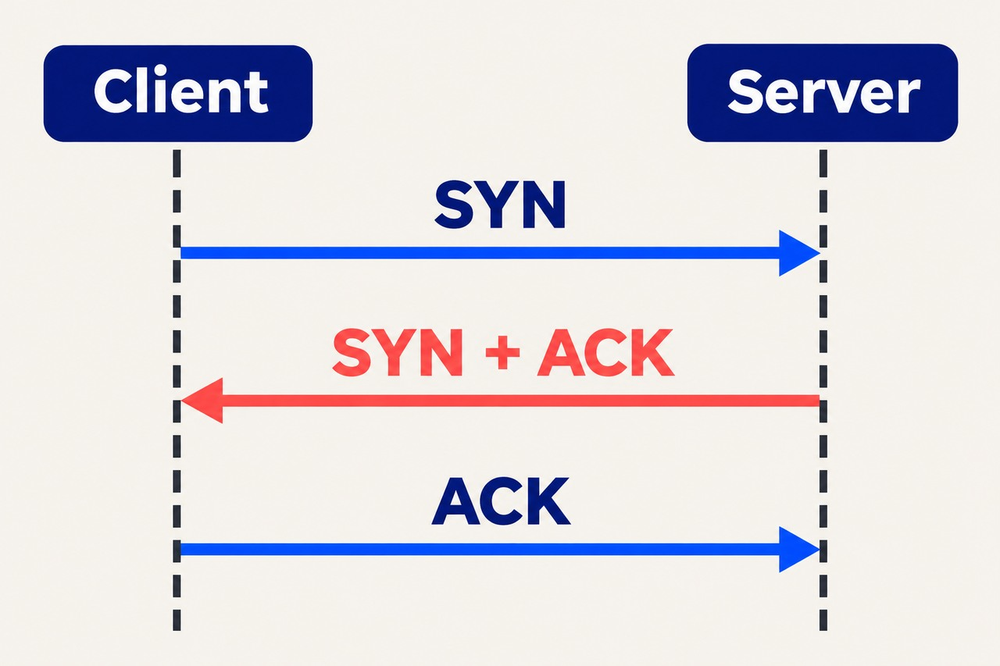
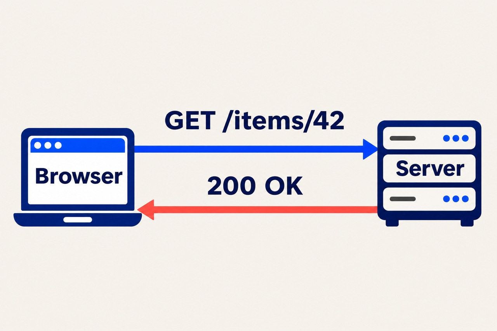
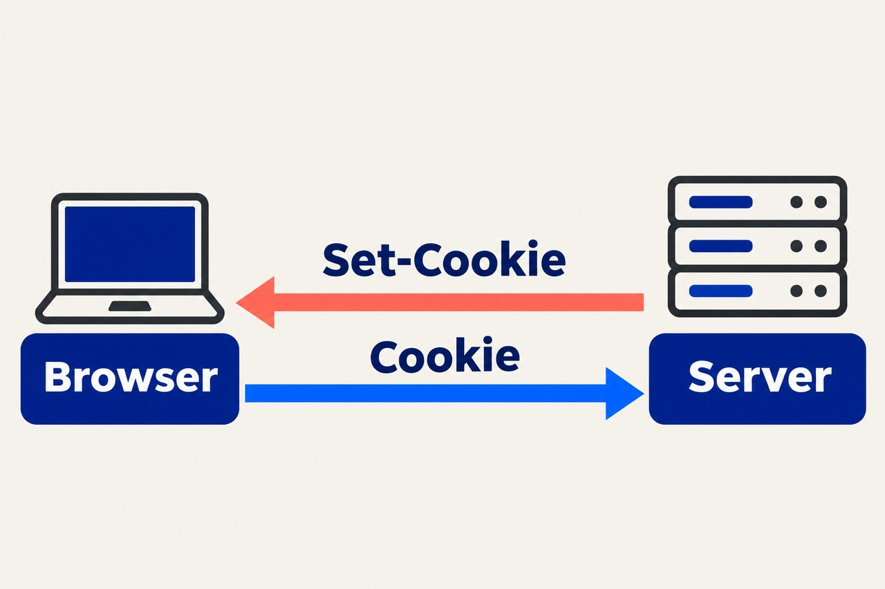
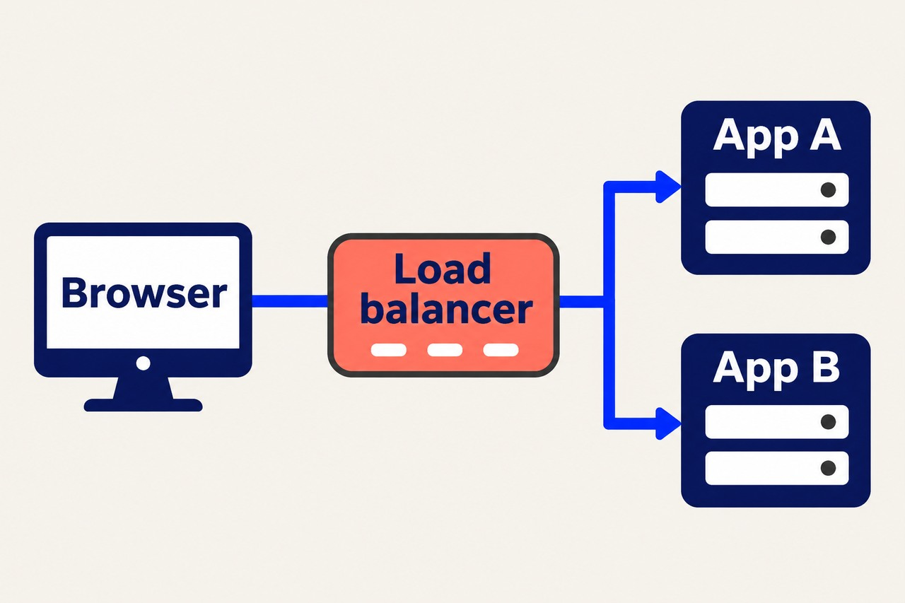
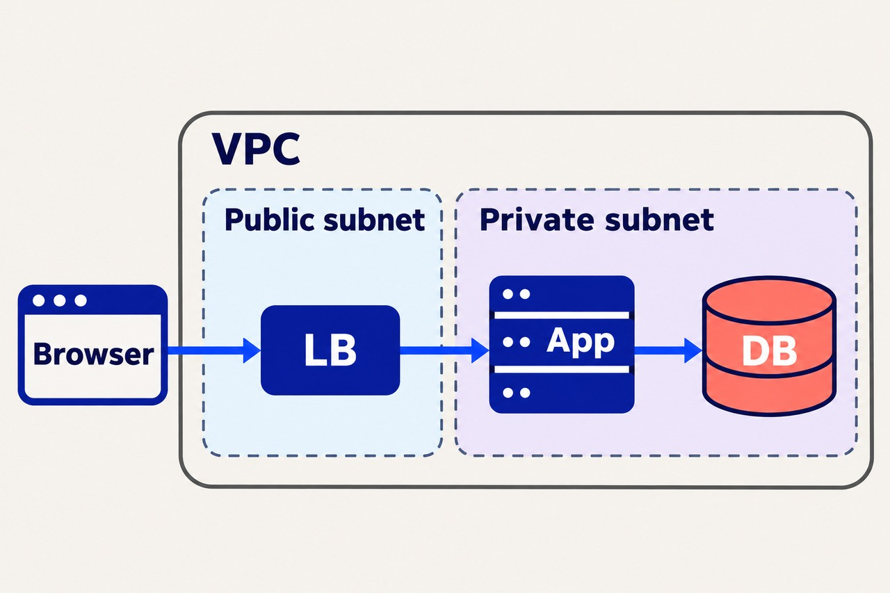
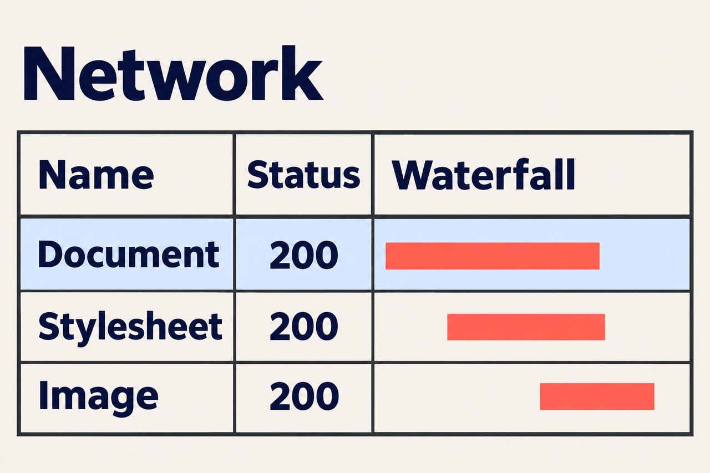

```html-embed
<p class="course-intro"><strong>この記事は、Udemyで公開中の動画講座『インターネットとWebシステムの全体像【動く図解でスッキリ理解】ネットワークの仕組みを基礎から実務の構成まで』の要点をまとめたものです。記事の末尾にクーポンを記載しているため、よろしければご利用ください。</strong></p>
<style>
  .course-intro { margin: 0; padding: 0.5rem; color: #b42323; background: #fff7f7; font: 1rem/1.7 system-ui, sans-serif; overflow-wrap: anywhere; }
  [data-theme="dark"] .course-intro { color: #ff9b9b; background: #2b1a1a; }
</style>
```

カフェの Wi-Fi につないだスマホで、ネットショップのマグカップをタップする。商品写真が出るまでに、スマホはどこへ、何を頼んでいるのでしょうか。

ここでは商品番号 `42` のページを開く、一回の操作を追います。前半はサーバー1台の構成、後半は CDN やロードバランサーを使う構成です。


先に、通信を二つの方向から見ておきます。**場所**で追うと「スマホ → カフェのルーター → 接続事業者（ISP）→ インターネット → お店のサーバー」です。**処理**で追うと「宛先を調べる → 接続する → 商品ページを頼む → 画面を描く」です。ルーターは通信を運び、ブラウザとサーバーは「何を頼み、何を返すか」を扱います。この二つを意識すると、ネットワーク構成図と HTTP の説明を結び付けやすくなります。

## 1. Wi-Fiにつなぎ、ネットワークの出口を知る

**Wi-Fi** は、スマホと近くのアクセスポイントを電波でつなぎます。この例では、アクセスポイントとインターネットへの出口であるルーターが1台の機器にまとまっています。


端末は **DHCP** などで、自分の IP アドレス、外部ネットワークへ出るためのデフォルトゲートウェイ、名前を問い合わせる DNS サーバーなどの設定を取得します。この準備は通常、リンクを開く前に済んでいます。



たとえばスマホに `192.168.1.10/24`、ゲートウェイに `192.168.1.1` が設定されたとします。`/24` は、この例で先頭24ビットがネットワークの範囲を表すという意味です。同じ範囲の `192.168.1.20` に送りたいなら、その端末を近くで探します。外部の `203.0.113.80` へ送りたいなら、まず `192.168.1.1` に渡します。Wi-Fi のアイコンが表示されていても、この先の接続事業者側が止まっていると外部サイトは開けません。

有線 LAN などでは、同じリンク内の宛先の識別に **MAC アドレス** を使います。たとえば IPv4 では、端末は **ARP** で出口のルーターの IP アドレスに対応する MAC アドレスを調べられます。外のサーバー宛ての IP パケットも、最初はこの近くのルーターへ渡します。



## 2. URLから接続先を見つける

例の URL は `https://shop.example.com/items/42` です。`https` は通信の方式、`shop.example.com` はホスト名、`/items/42` は商品ページを指定するパスです。


接続先の IP アドレスが手元にない場合、端末は **DNS** にホスト名を問い合わせます。問い合わせを受けるリゾルバーは、必要に応じて権威 DNS サーバーをたどり、結果を返します。DNS が調べるのはホスト名です。商品を指定するパスは、あとで HTTP リクエストに使います。



リゾルバーに答えが残っていない場合をもう少し具体的に見ると、ルート DNS から `.com` の担当を教えてもらい、次に `example.com` の担当へ問い合わせます。最終的な担当が、たとえば IPv4 の **A レコード**として `203.0.113.80` を返します。IPv6 の接続先を調べるレコードは **AAAA** です。結果は指定された期間を目安にキャッシュされるため、同じサイトを開くたびに、この一連の問い合わせが発生するわけではありません。URL と IP は説明用の例です。

## 3. ルーターを経由してデータを運ぶ

インターネットは、接続事業者などが運用するネットワークの集まりです。各 **ルーター** は宛先 IP アドレスと経路表を見て、パケットを次に渡す先を決めます。


家庭やカフェの IPv4 ネットワークでは、複数の端末が一つの外向き IP アドレスを共有する構成がよくあります。**NAT** の一種である NAPT は、送信元の IP アドレスとポート番号を変換し、対応を記録します。応答が戻ると、対応表を使って元の端末に届けます。


この通信でスマホの送信元を `192.168.1.10:53012`、カフェ側の外向きを `198.51.100.5:62001` とします。ルーターがこの組を記録すれば、外から `62001` 宛てに戻ってきた TCP の応答を、スマホの `53012` に対応づけられます。別の端末も同じ外向き IP を使えます。なお、ポート番号は、同じ IP アドレスで動く複数のサービスや通信を区別する手掛かりです。

HTTP/1.1 や HTTP/2 を HTTPS で使う場合、新規接続では通常 **TCP** で通信を始めます。接続先ポートは既定で `443` です。TCP は届かなかったデータを再送するなどして、受信側が順序どおりのバイト列を受け取れるようにします。



ここまでの仕組みを重ねると、アプリケーションのデータを **TCP** が運び、**IP** がネットワークをまたぐ宛先を示し、**リンク層**が次の機器へ届けます。層ごとに必要な情報を付けることを **カプセル化** と呼びます。スマホのすぐ隣にいるのはルーターなので、最初の区間ではルーターに渡しつつ、IP の宛先にはお店の接続先を書けます。

## 4. HTTPSでリクエストと応答をやりとりする

**TLS** のハンドシェイクでは、ブラウザがサーバー証明書を検証し、通信を暗号化するための鍵を準備します。**HTTPS** は、このように保護された接続で行う HTTP 通信です。HTTP/3 では、TCP を使う例とは接続の作り方が異なり、UDP 上の QUIC に TLS の仕組みが組み込まれます。


TLS が確認するのは、ブラウザが指定したホスト名と証明書の対応、信頼できる認証局につながるか、有効期限内か、といった点です。証明書が合わない場合、HTTP の応答が返る前に接続が止まることがあります。また、実務では TLS の接続相手が CDN やロードバランサーのこともあります。その場合、そこから先の通信はシステム側で別に設計します。

ブラウザが `GET /items/42` を送ると、サーバーはたとえば `200 OK` と商品ページの HTML を返します。パスの処理はサーバー側の設定次第で、保存済みのファイルを返す場合も、在庫や価格を調べてその場でページを組み立てる場合もあります。



HTTP の応答には、結果を示す **ステータス**、付加情報を示す **ヘッダー**、実際に返す HTML などの **本文**があります。典型的な例では `200` が成功、`404` が要求した対象を見つけられないとき、`503` がサービスを一時的に利用できないときです。ページ全体で一つのステータスが決まるわけではなく、メインの HTML が `200` でも、商品写真の URL が `404` なら写真だけ表示されません。

## 5. ブラウザが商品ページを描く

ブラウザは HTML を読み、必要に応じて CSS、JavaScript、商品写真などを取得します。HTML が構造を表し、CSS が見た目を指定し、JavaScript がカートボタンの反応などを担当します。追加の通信があるため、ページを一度開くだけでも、複数のリクエストが発生します。


カートを次のページでも使えるようにするには、たとえばサーバーが **Cookie** にセッション ID を設定します。ブラウザが次のリクエストでその Cookie を送ると、サーバーは対応するカートの状態を参照できます。



HTML を取得した時点では、画像の配置や見た目はまだ確定していません。ブラウザは HTML から要素の木を作り、CSS を適用し、要素の位置や大きさを計算して描きます。JavaScript が後から API に在庫を問い合わせて、画面の一部を更新する構成もあります。開発者ツールで HTML の行だけが先に終わって見えるとき、この後の処理時間を考えると理由が分かります。

## 6. 実務ではサーバー側の仕事を分ける

同じ商品ページでも、**Web の入口**がアクセスを受け、**アプリケーション**が価格や在庫を処理し、**データベース**が情報を保持する構成にできます。外からのリクエストを受けて内部へ転送するリバースプロキシも、入口の役割を担えます。


- **ロードバランサー**は、複数の処理先にアクセスを振り分けます。ヘルスチェックと組み合わせれば、異常な処理先を一時的に外せます。



- **CDN** は利用者に近いエッジからコンテンツを配信します。商品写真のキャッシュがあればエッジから返し、取得が必要なら配信元のオリジンへ問い合わせます。


- **WAF** は HTTP リクエストを規則に照らして検査し、該当する通信をブロックできます。クラウドでは **VPC** とサブネットを使って、外部に開く入口と内部で使うアプリや DB を分ける構成が取れます。




たとえば商品ページ本体は、ロードバランサーの奥にあるアプリが商品番号 `42` を使って DB に問い合わせ、価格・在庫を含む HTML を組み立てます。その HTML に載っている商品画像は、別のリクエストとして CDN のキャッシュから返せます。画像が先に見えるか、在庫表示が後から変わるかは、それぞれの取得方法と描画の順番次第です。

会社のネットワークから開く場合は、手前に社内 DNS、プロキシ、VPN などが加わることもあります。カフェでは見えていたページが社内からだけ開かないなら、Web サービス側に加えて、社内ネットワークの名前解決や出口も確認対象になります。

## 自分のブラウザで確かめる

PC の Chrome で開発者ツールの **Network** を開いてから、公開ページを再読み込みします。種類が `document` の行を開くと、`Headers` で URL・メソッド・ステータスを、`Timing` で通信の内訳を確認できます。CSS や画像の行も探してみると、**ページの表示には複数の通信が関わる**ことが分かります。



次にページが開けないときは、**回線につながるか → 名前が引けるか → HTTPS が成立するか → HTTP の応答があるか**と、どこまで進んだかを考えると、調べる範囲を絞れます。


### 開かないときに見る順序

| 観察できたこと | 次に確かめること |
| --- | --- |
| 同じ Wi-Fi につないだ複数の端末で、どのサイトも開かない | ルーターや外部回線の状態。別の回線では開くか |
| あるホスト名だけ解決できない | URL の入力と DNS の結果。Windows なら `nslookup example.com` で問い合わせの例を確認できる |
| 証明書のエラーが出る | URL のホスト名、端末の時刻、表示された証明書エラーの内容 |
| HTML は `200` で画像だけ `404` | 画像リクエストの URL、参照先の配信設定 |
| ページは出るが表示が遅い | 最初の文書と後から取得する画像・CSSを分けて、待ち時間の長い行を調べる |

一つの結果から原因を断定する必要はありません。たとえば `404` が見えていれば、まず URL と応答内容を確認するところから始められます。

記事の下書きに生成AIを使用し、図版と機器のイメージは ChatGPT Images で作成しました。

### 参考資料

- [RFC 1034 — DNS の概念](https://www.rfc-editor.org/rfc/rfc1034.html)
- [RFC 8446 — TLS 1.3](https://www.rfc-editor.org/rfc/rfc8446.html)
- [RFC 9110 — HTTP のセマンティクス](https://www.rfc-editor.org/rfc/rfc9110.html)
- [RFC 9114 — HTTP/3](https://www.rfc-editor.org/rfc/rfc9114.html)
- [Chrome DevTools — Network features reference](https://developer.chrome.com/docs/devtools/network/reference/)

## Udemy講座とクーポン

講座「インターネットとWebシステムの全体像」では、同じ商品ページの例を動く図解で追い、ルーティングやキャッシュ、クラウド、会社のネットワークまで扱います。以下はこの講座のクーポンです。

| クーポン | URL | コード | 有効期限（日本時間） |
| --- | --- | --- | --- |
| 無料1（先着10名） | [無料クーポン1を適用](https://www.udemy.com/course/internet-web-system-overview/?couponCode=2DEF00F4858110F52417) | `2DEF00F4858110F52417` | 2026年11月26日 19:17 |
| 無料2（先着100名） | [無料クーポン2を適用](https://www.udemy.com/course/internet-web-system-overview/?couponCode=6E48FC0380F589C574C5) | `6E48FC0380F589C574C5` | 2026年12月22日 20:44 |
| 割引 | [割引クーポンを適用](https://www.udemy.com/course/internet-web-system-overview/?couponCode=AA08F8D0148C064E4415) | `AA08F8D0148C064E4415` | 2026年12月22日 20:45 |

無料枠は、期限内でも人数の上限に達すると終了します。登録の確定前に、Udemy 上の適用後の価格をご確認ください。

よければ評価とコメントをお願いします！動画の改善の参考にさせていただきます！
