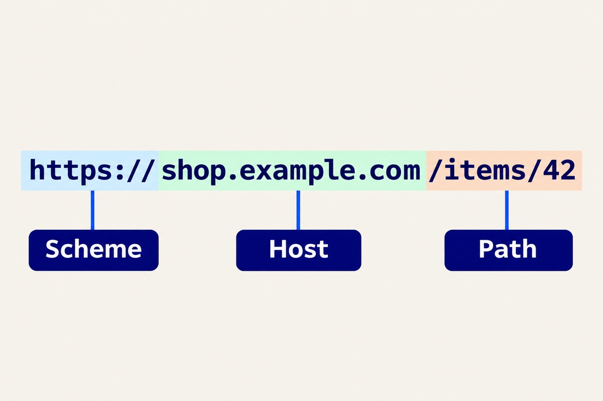
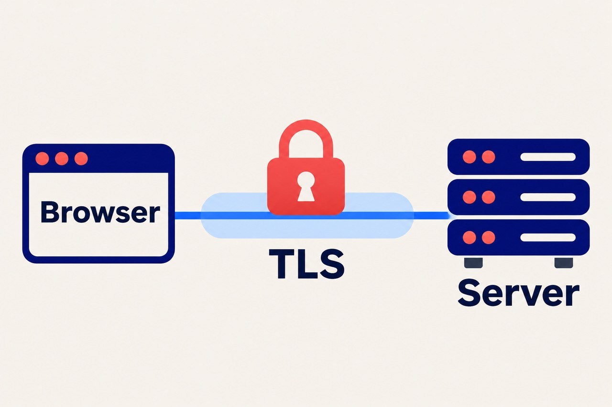
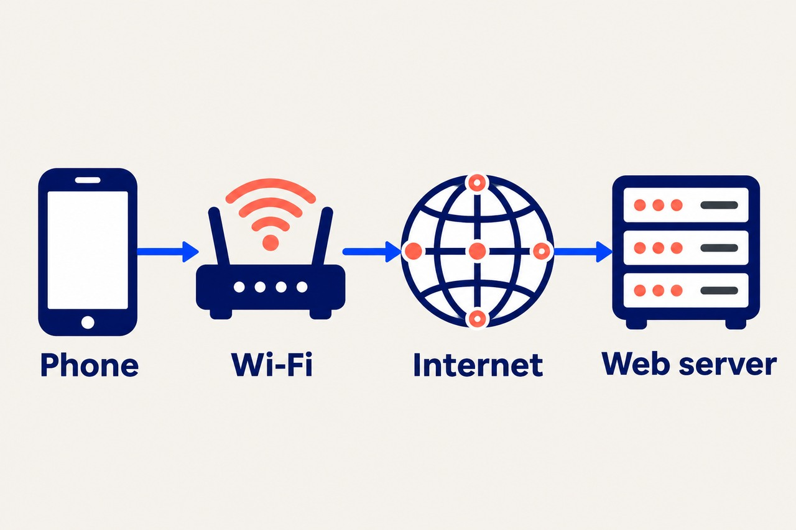
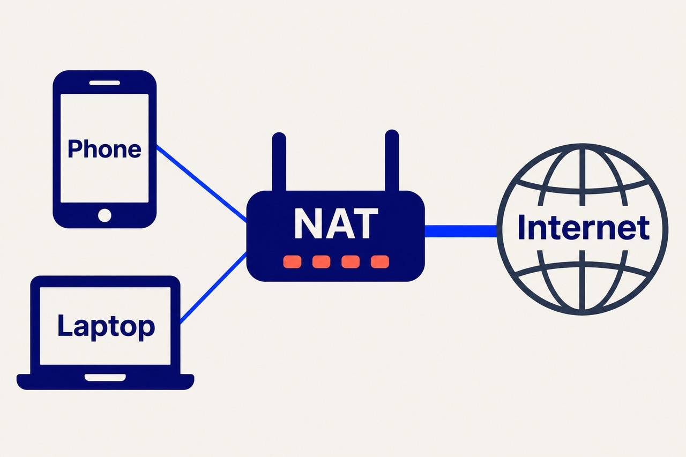
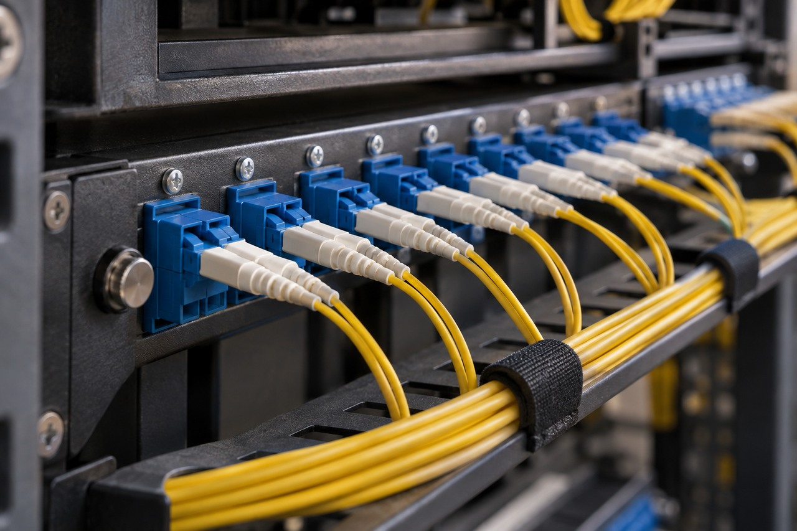
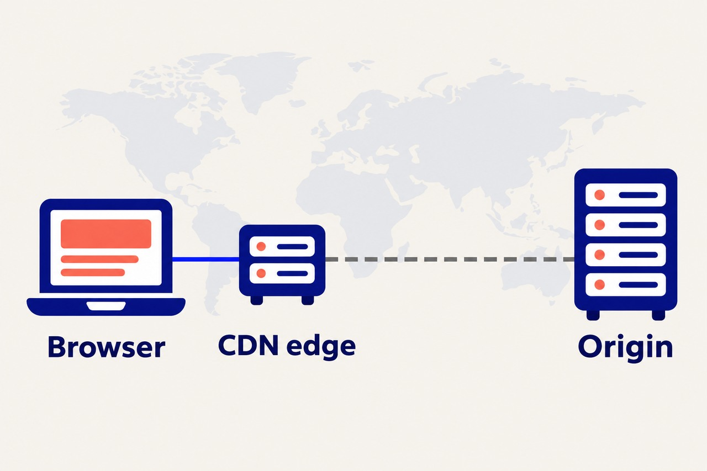
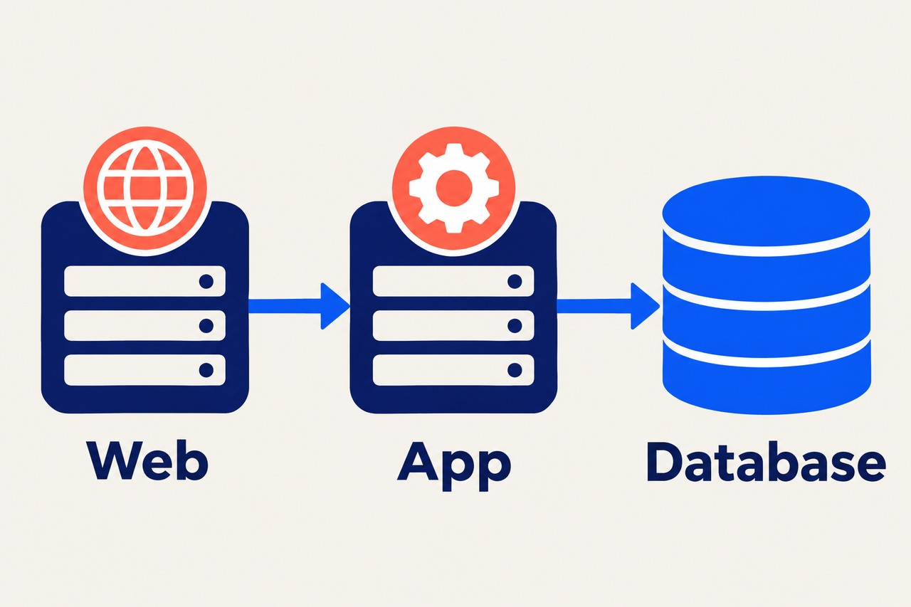
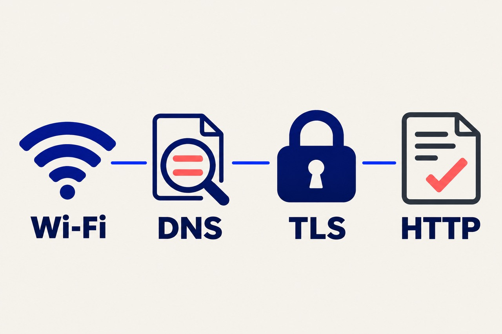

```html-embed
<p class="course-intro"><strong>この記事は、Udemyで公開中の動画講座『インターネットとWebシステムの全体像【動く図解でスッキリ理解】ネットワークの仕組みを基礎から実務の構成まで』の要点をまとめたものです。記事の末尾にクーポンを記載しているため、よろしければご利用ください。</strong></p>
<style>
  .course-intro { margin: 0; padding: 0.5rem; color: #b42323; background: #fff7f7; font: 1rem/1.7 system-ui, sans-serif; overflow-wrap: anywhere; }
  [data-theme="dark"] .course-intro { color: #ff9b9b; background: #2b1a1a; }
</style>
```

商品ページは表示されるのに、写真だけ出てこない。そんなとき、ブラウザの **Network** パネルを見ると、HTML と写真が別々のリクエストで取得されていることが分かります。

カフェの Wi-Fi でネットショップを開く例を使い、Network パネルで見える記録から、端末・インターネット・サーバーの役割をたどります。


## まず、ページを1回読み直す

PC の Chrome で公開ページを開き、開発者ツールの **Network** タブを選んでから再読み込みします。上の図は操作画面の模式図です。実際の画面では次の3点を見てください。

1. **Type** が `document` の行を選ぶ。メイン文書のリクエストです。
2. **Headers** で URL、メソッド、ステータスを確認する。
3. **Timing** を開き、続いて一覧で画像や CSS の行を確認する。

ブラウザのキャッシュを使った通信を一度除いて観察したい場合は、開発者ツールを開いたまま **Disable cache** にチェックを入れて再読み込みします。この設定で CDN 側のキャッシュまで無効になるわけではありません。


HTML はページの構造を記述します。ブラウザはそれを読み、必要な CSS、JavaScript、画像を追加で取得して描画します。写真だけ出ないときに HTML の `200` と画像のステータスを分けて見るのは、それぞれに応答があるからです。

### 3種類の通信を手元で作る

動きを見分けやすくするため、同じフォルダに `index.html`、`style.css`、好きな画像 `cup.jpg` の3ファイルを置きます。CSS は `h1 { color: navy; }` の1行で十分です。

```html
<!doctype html>
<meta charset="utf-8">
<title>商品ページの練習</title>
<link rel="stylesheet" href="style.css">
<h1>マグカップ</h1>

```

そのフォルダで Python の簡易サーバーを起動し、Chrome で `http://127.0.0.1:8000/` を開きます。ファイルがそろっていれば、再読み込み時に文書・CSS・画像のリクエストが並びます。

```console
python -m http.server 8000 --bind 127.0.0.1
```

次に HTML 内の画像名を `missing.jpg` に変えて保存し、再読み込みします。文書の `200` と画像の `404` を同時に観察できます。画像の行を選べば、存在しない名前をブラウザが要求したことを `Headers` で追えます。この練習では HTTP を使うため、DNS と TLS の観察には普段使う公開 HTTPS ページを開いてください。

## Headersから分かること

商品ページに相当する例を `https://shop.example.com/items/42` とします。`https` は通信の方式、`shop.example.com` はホスト名、`/items/42` はパスです。商品番号を含むパスが、サーバー側の処理を選ぶ手がかりになります。



たとえばブラウザは `GET /items/42` を送り、商品ページを受け取ります。`200` はリクエストが成功した応答、`404` は対象が見つからない場合などの応答です。ステータスが返っていれば、少なくともそのリクエストには HTTP で応答した機器があります。


| Headersで見る項目 | 商品ページの例 | 読み取れること |
| --- | --- | --- |
| Request URL | `https://shop.example.com/items/42` | ブラウザが要求したホストとパス |
| Request Method | `GET` | このリクエストがコンテンツを取得する操作であること |
| Status Code | `200`、`404` など | この一件に対してどんな応答が返ったか |
| Content-Type | `text/html`、`image/jpeg` など | 相手が応答本文をどの形式として送ったか |

Headers の値とあわせて **Initiator** を見ると、HTML の読み取りで画像取得が始まったのか、JavaScript が別の通信を始めたのかを追えます。画像だけ表示されない場合は、一覧を `Img` で絞り込み、該当するリクエストの URL、ステータス、応答を順に見ます。

リクエストの **Cookie** は、前のやりとりでサーバーが設定した情報などを、送信条件に合うリクエストに載せる仕組みです。たとえばセッション ID を送れば、アプリケーションはどのカートを表示するか判断できます。


## Timingの手前にある仕組み

タイミングは、**接続の準備にかかった時間**と、**HTTP の応答を待って受け取る時間**に分けて読むと役立ちます。再読み込みのたびに同じ内訳になるとは限りません。名前情報のキャッシュや接続の再利用があると、DNS や接続確立がそのリクエストの行に出ないことがあります。

### 名前を引く

**DNS** が問い合わせる対象はホスト名です。ブラウザが新しい接続先を探すとき、DNS でその名前に対応する IP アドレスを調べます。名前解決の結果がキャッシュに残っている場合、毎回問い合わせが発生するわけではありません。


### 接続して暗号化する

HTTP/1.1 や HTTP/2 を HTTPS で使う典型例では、TCP 接続を確立した後に TLS を開始します。TCP は欠落を再送して順序どおりのバイト列を届けます。既存の接続を再利用すれば、同じ準備をやり直す必要がない場合があります。


TLS では証明書で接続相手を検証し、HTTP を暗号化します。HTTP/3 の通信では、TLS の処理を組み込んだ **QUIC** が UDP 上で接続を確立します。Network パネルの Protocol 列を表示すると、`h2` や `h3` など、利用した HTTP のバージョンを見分けられます。



### 応答を待つ時間と、ダウンロード時間を分ける

| Timingの項目 | 見ている時間 | 長いときの調べ方 |
| --- | --- | --- |
| DNS Lookup | ホスト名を解決する時間 | 同じホストの最初の取得か、繰り返し取得でも出るかを比べる |
| Initial connection / SSL | 接続の確立や暗号化の準備 | 接続再利用の有無と、Protocol に表示される HTTP の方式を確認する |
| Waiting for server response（TTFB） | リクエスト送信後、応答の最初のバイトを待つ時間 | HTML と画像、初回と再読み込みで比べる。通信の往復と応答側の処理の両方が含まれる |
| Content Download | 応答本文の受信にかかった時間 | 同じ種類のリクエストの転送量と、使った回線条件を比べる |

たとえば最初の HTML はすぐ返るのに、Waterfall 上で大きな画像の棒だけが長く続く場合、その画像の転送量とダウンロード時間を先に確認できます。逆に HTML の TTFB が長い場合、ブラウザの計測だけでデータベースの遅延とは判断できません。どのホストが応答したかを確かめ、必要に応じてサーバー側のログや計測で調べます。

### そもそもパケットはどこを通る？

PC やスマホは、近くのアクセスポイントと Wi-Fi でつながります。カフェのルーターでは、アクセスポイントの役割を兼ねる場合があります。


端末はネットワークへ参加するときに、**DHCP** などで自分の IP アドレスや外に出るためのゲートウェイの情報を受け取ります。Wi-Fi につないでからページを開くなら、この処理は通常、HTTP の計測より前です。


同じ LAN での配送には、MAC アドレスなどリンク内で使う識別子が関わります。LAN を出た後は、宛先の IP アドレスをもとにルーターがパケットを中継します。




IPv4 の構成では、**NAT** を使って端末側のアドレスを変換する場合があります。一般的な NAPT ではポート番号も変換し、応答を元の端末に振り分けます。



インターネットを構成するネットワーク間では、光ファイバーなどを使ってパケットが運ばれます。ブラウザに表示される Timing は端末側から見た計測です。パケットが通ったルーターすべてを示す画面ではありません。



## HTMLと画像が返る場所は違うことがある

写真を **CDN** にキャッシュしている構成なら、利用者に近いエッジから写真を返せます。エッジが応答できない場合は配信元のオリジンに取りに行きます。価格や在庫を都度調べる商品ページは、ここではオリジンで組み立てる構成を例にします。



### 同じ画像を2回開いてキャッシュを観察する

同じ公開ページを、**Disable cache** を外して2回読み込みます。画像行の **Size** に `memory cache` や `disk cache` と出れば、ブラウザが手元のコピーを使ったことが分かります。`304 Not Modified` が見えた場合は、ブラウザが相手に変更の有無を問い合わせ、更新不要と返された結果です。同じページでも、設定次第で毎回 `200` が返ることがあります。

CDN のキャッシュは別の場所にあります。ブラウザのキャッシュを無効にしても、CDN が保持している画像を返すことはあります。サービスが `Age` やキャッシュ状態を示す独自のヘッダーを返す場合は、それを手掛かりにできます。ヘッダーの名前と意味はサービスごとに確認します。

オリジンの入口では、**ロードバランサー**が正常なアプリケーションサーバーへトラフィックを振り分けます。**WAF** を置く構成なら、HTTP リクエストを検査して、ルールに該当する通信を止められます。


Web の入口から受け取った商品番号をアプリケーションが処理し、データベースから価格と在庫を読み出します。こうして作られた HTML がブラウザに返り、画像などの追加取得が続きます。



クラウドの **VPC** は、このようなリソースを置く論理的に分離されたネットワークです。外部に公開する入口と、内部で通信するアプリケーションやデータベースを、サブネットや通信規則で分けられます。


## 読み終えたら、1つのリクエストで確認する

Network で HTML と画像を1件ずつ選び、**どのホストに、何を要求し、どんな応答が返ったか**を比べてみてください。ページが表示されないときは、まず回線、DNS、TLS、HTTP のどこに手掛かりがあるかを絞ると、次に見る場所が決まります。



「写真だけ出ない」を調べるなら、最初に `document` の行でページ本体の応答を確認し、次に `Img` の行を開きます。画像が `404` なら URL と配信先、`200` で表示されないなら応答の形式や CSS による表示状態が確認対象です。タイムアウトが出るなら、画像だけ別のホストを使っていないかを確認すると、回線や名前解決の問題を切り分けやすくなります。

記事の下書きに生成AIを使用し、図版と機器のイメージは ChatGPT Images で作成しました。

### 参考資料

- [Chrome DevTools — Network features reference](https://developer.chrome.com/docs/devtools/network/reference/)
- [RFC 9110 — HTTP のセマンティクス](https://www.rfc-editor.org/rfc/rfc9110.html)
- [RFC 9114 — HTTP/3](https://www.rfc-editor.org/rfc/rfc9114.html)
- [AWS ドキュメント — Amazon VPC とは](https://docs.aws.amazon.com/ja_jp/vpc/latest/userguide/what-is-amazon-vpc.html)

## Udemy講座とクーポン

講座「インターネットとWebシステムの全体像」では、同じ商品ページの例を動く図解で追い、ルーティングやキャッシュ、クラウド、会社のネットワークまで扱います。以下はこの講座のクーポンです。

| クーポン | URL | コード | 有効期限（日本時間） |
| --- | --- | --- | --- |
| 無料1（先着10名） | [無料クーポン1を適用](https://www.udemy.com/course/internet-web-system-overview/?couponCode=2DEF00F4858110F52417) | `2DEF00F4858110F52417` | 2026年11月26日 19:17 |
| 無料2（先着100名） | [無料クーポン2を適用](https://www.udemy.com/course/internet-web-system-overview/?couponCode=6E48FC0380F589C574C5) | `6E48FC0380F589C574C5` | 2026年12月22日 20:44 |
| 割引 | [割引クーポンを適用](https://www.udemy.com/course/internet-web-system-overview/?couponCode=AA08F8D0148C064E4415) | `AA08F8D0148C064E4415` | 2026年12月22日 20:45 |

無料枠は、期限内でも人数の上限に達すると終了します。登録の確定前に、Udemy 上の適用後の価格をご確認ください。

よければ評価とコメントをお願いします！動画の改善の参考にさせていただきます！
